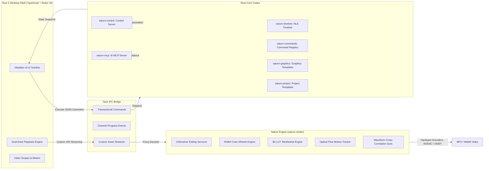

<div align="center">


# Easy Edits Pro

**力と美のために** &middot; *Precision, Performance & Power for Modern Linux Video Editing.*

[](https://github.com/sponsors/zvirox)
[](https://ko-fi.com/zvirox)

<br />

[](LICENSE)
[](https://www.rust-lang.org/)
[](https://v2.tauri.app/)
[](https://react.dev/)
[](https://www.typescriptlang.org/)
[](https://gstreamer.freedesktop.org/)
[](https://github.com/zvirox/easy-edits-pro)

<br />

Easy Edits Pro is a high-performance, non-linear desktop video editor engineered in Rust and Tauri 2 for Linux. Designed to combine the workspace fluidity of DaVinci Resolve, the rich asset shelf ergonomics of Wondershare Filmora, and the cutting precision of Adobe Premiere Pro—all inside an obsidian-dark interface crafted specifically for modern Linux desktop rices (Hyprland, Niri, Sway, GNOME, and KDE).


<kbd>[Overview](#about)</kbd> &middot; <kbd>[Workspaces](#workspaces-suite)</kbd> &middot; <kbd>[Key Capabilities](#key-capabilities)</kbd> &middot; <kbd>[Architecture](#core-architecture)</kbd> &middot; <kbd>[Quick Start](#quick-start)</kbd> &middot; <kbd>[Roadmap](#development-roadmap)</kbd> &middot; <kbd>[Connect](#connect--follow)</kbd>

</div>

---

<div align="center">


<sub><b>The Easy Edits Pro Desktop Suite.</b> Multi-track timeline, DaVinci Resolve workspace ribbon, Filmora left asset shelf, Premiere tool rail, multi-cam quad split, and Fairlight audio console.</sub>

</div>

---

## About

Easy Edits Pro (originally *Project Saturn*) is an open-source, framework-independent desktop video editor built from first principles for Linux creators. Traditional Linux editors often force a choice between unstable monolithic wrappers or clunky legacy interfaces. Easy Edits Pro bridges that gap with a modern, decoupled architecture:

1. **Rust Core Engine (`saturn-core`):** A rock-solid, zero-drift rational timebase (`254,016,000,000` integer ticks/second) that manages sequences, clips, transitions, keyframes, bus routing, and transactional command history with instantaneous atomic undo/redo.
2. **GStreamer Render Engine (`saturn-render`):** Direct hardware-accelerated video decoding, 3D LUT tetrahedral interpolation, optical flow motion displacement tracking, audio cross-correlation sync, and GStreamer Editing Services (GES) multi-job rendering.
3. **Fluid Tauri 2 Shell (`saturn-tauri`):** A responsive, hardware-accelerated UI styled in obsidian dark (`#080a0f`) with 1px glowing borders, neon cyan/violet accents, real-time SVG audio waveforms, and tactile feedback built to complement tiling compositors like Hyprland and Niri.

---

## Workspaces Suite

Easy Edits Pro mirrors the streamlined, task-oriented workflow of industry-standard post-production suites through its integrated workspace ribbon:

<table>
  <tr>
    <td width="50%">
      <h3>1. Media Studio <kbd>Shift + 1</kbd></h3>
      <p>High-density project media bin with multi-file drag-and-drop, asynchronous GStreamer metadata probing, live cached video/audio proxies, and integrated Openverse FOSS stock media search.</p>
    </td>
    <td width="50%">
      <h3>2. Edit Suite <kbd>Shift + 2</kbd></h3>
      <p>Multi-track timeline with Premiere Pro tool rail (<kbd>V</kbd>, <kbd>A</kbd>, <kbd>B</kbd>, <kbd>C</kbd>, <kbd>Y</kbd>, <kbd>P</kbd>, <kbd>H</kbd>, <kbd>Z</kbd>), dual-deck preview staging (Deck A / Deck B), frame snapping, and real-time SVG waveform display.</p>
    </td>
  </tr>
  <tr>
    <td width="50%">
      <h3>3. Color Grading Studio <kbd>Shift + 3</kbd></h3>
      <p>Color wheels and basic grading state are connected to project clips. Advanced curves, HSL controls, presets, LUT loading, and scopes remain in development.</p>
    </td>
    <td width="50%">
      <h3>4. Fairlight Audio Studio <kbd>Shift + 4</kbd></h3>
      <p>Multi-track mixer with gain, pan, mute/solo, bus routing, EQ/compression controls, meters, and Read-mode volume/pan automation playback. Plugin slots currently store metadata; native VST3 hosting is not available.</p>
    </td>
  </tr>
  <tr>
    <td width="50%">
      <h3>5. Effects &amp; Keyframes <kbd>Shift + 5</kbd></h3>
      <p>Clips support effect stacks and keyframes. Effect reorder/parameter editing and keyframe tangent-handle editing are unfinished; motion tracking is available as a separate engine workflow.</p>
    </td>
    <td width="50%">
      <h3>6. Delivery &amp; Batch Queue <kbd>Shift + 6</kbd></h3>
      <p>MP4/WebM rendering and asynchronous MCP render jobs are available. The export queue UI and hardware output still need verification; this machine rendered with the x264 software encoder.</p>
    </td>
  </tr>
</table>

---

## Key Capabilities

### 🎥 Multi-Cam Synchronized Editing
- **Audio Waveform Cross-Correlation:** Automatically synchronizes multi-angle footage by cross-correlating decoded audio waveforms, calculating lag offsets with sub-millisecond precision.
- **2x2 Quad-Split Monitor:** Displays Angles 1–4 simultaneously in the Program stage.
- **Live Tally Indicator:** Active on-air angle glows in brilliant broadcast red with an `ON AIR` badge, while hovered preview tiles display a green tally border.
- **One-Key Angle Switching:** Cut live between camera angles on the fly using number keys <kbd>1</kbd>, <kbd>2</kbd>, <kbd>3</kbd>, and <kbd>4</kbd> during playback.

### 🎨 Color Grading &amp; 3D LUTs
- **Primary Color Wheels:** Lift modulates shadows ($1 - v$), Gamma curves midtones ($v^{1 - 0.5\gamma}$), Gain expands highlights ($v \cdot (1 + \text{gain})$), and Offset translates the pedestal across RGBA.
- **3D LUT (.cube) Support:** Parses standard $17\times17\times17$ to $64\times64\times64$ 3D LUT files and interpolates RGB color tables in-place.
- **GPU Scopes:** Real-time visual monitoring via Vectorscope, Waveform Monitor, RGB Parade, and Luminance Histogram.

### 🎯 Motion Tracking &amp; Camera Stabilization
- **Lucas-Kanade Optical Flow Tracker:** Tracks sub-pixel patch displacements frame-by-frame across high-motion sequences.
- **Camera Shake Stabilization:** Smooths raw trajectory curves using a Gaussian low-pass filter and applies real-time inverse transformation matrices.
- **Sticker &amp; Overlay Pinning:** Locks titles, lower-thirds, or graphic overlays to tracked object coordinates.
- **On-Screen Tracking Target:** High-visibility dashed crosshair overlay with corner brackets on the Program monitor.

### 🎚️ Fairlight Multitrack Mixer &amp; Automation
- **Console Strips:** Track gain and pan, mute/solo/lock controls, stereo VU meters, live EQ, compressor, and high-pass cleanup controls.
- **Audio routing:** Track routes and bus gain settings are stored in the project and reflected in the Web Audio playback graph.
- **Automation modes:** Off/Read/Touch/Latch/Write modes and automation data are stored; Read-mode volume and pan curves now play back with interpolation.
- **Plugin slots:** Slot metadata can be added and toggled, but EEP does not yet host native VST3 plugins or process those slots.
- **Loudness:** Live browser playback meters use the EBU R128 meter and support EBU, streaming, and ATSC target standards.

### ⚡ Batch Render Queue &amp; Background Worker
- **Thread-Safe Daemon:** Multi-threaded Rust worker daemon (`saturn-core/src/job.rs`) with prioritized execution (`Immediate`, `High`, `Normal`, `Background`) and cooperative cancellation tokens.
- **Pause &amp; Resume:** Pause active rendering without dropping frame buffers, allowing resource recovery for foreground editing.
- **Hardware Acceleration:** Auto-probes Linux hardware encoders: NVIDIA NVENC (`nvcodec`), Intel Quick Sync (`vaapi`/`qsv`), AMD AMF / VA-API (`vaapih264enc`), with seamless CPU fallback (`x264enc`).

### 📝 Dedicated Subtitle Track &amp; CC
- **Timeline Subtitle Lane:** Independent subtitle card track on the sequence with auto-wrapping text blocks and live preview rendering.
- **Standards Compliant:** One-click import and export for both `.srt` (SubRip) and `.vtt` (WebVTT) formats.

---

## Core Architecture

For the current module map and runtime data flow, see the [architecture guide](docs/architecture.md).

Easy Edits Pro enforces a strict separation between domain state, native rendering, and UI presentation:



### Rational Integer Timebase
To avoid accumulated frame drift over long sequences, Easy Edits Pro calculates all time values in exact integer ticks:

$$\text{Ticks Per Second} = 254{,}016{,}000{,}000$$

`TICKS_PER_SECOND = 254_016_000_000`

This tick base is evenly divisible by all broadcast and digital frame rates: **23.976**, **24**, **25**, **29.97**, **30**, **48**, **50**, **59.94**, and **60 fps**, as well as pro audio sample rates (**44.1 kHz**, **48 kHz**, **96 kHz**, and **192 kHz**).

---

## Core Crates

### saturn-timeline — Professional NLE Timeline
FilmCraft-inspired timeline with 254B ticks/sec resolution:
- **Nested sequences** with full composition support
- **Atomic edits** with instant undo/redo via transactional history
- **Track kinds**: Video, Audio, Subtitle, Submix with blend modes
- **Clip timing**: Variable speed, reverse, frame blending, trim handles
- **Effects stack**: Video/audio effects, color grade (Lift/Gamma/Gain/Offset), transforms
- **Markers**: Chapter, web link, flash cue, comment, sync point

### saturn-commands — Unified Command Registry
Single source of truth for all automation interfaces:
- **CommandSpec** with JSON Schema parameter validation
- **CommandRegistry** with categories, priorities, execution modes
- **ShortcutManager** for global keybindings (Ctrl/Cmd + key)
- **UndoManager** with grouped transactions and checkpoints
- Used by Tauri IPC, CLI, MCP server, and Control Server

### saturn-control — Control Server
External automation via TCP/Unix socket:
- `--control PORT` starts JSON-RPC server
- Execute commands, query state, subscribe to events
- IDE integration, stream deck, OSC, MIDI controllers

### saturn-graphics — Graphics Templates (.sgt)
Motion graphics templates with keyframe animation:
- **TemplateInstance** with parameter bindings
- **Keyframe** cubic bezier interpolation (ease in/out)
- **FCGT-like** format for cross-compatibility
- Text, shape, image, video layers with transform stack

### saturn-project — Project Templates & Search Bins
- **Project templates** with predefined tracks, bins, settings
- **Search bins** with live queries (rating, tags, media type, duration)
- **Smart folders** auto-populate from metadata

### saturn-mcp — MCP Server for AI Editing
Model Context Protocol stdio server connected to `saturn-core::EditorEngine`:
- **Available tools**: discover and run engine commands, inspect projects/sequences, search project media, and inspect media placements
- **Project session**: headless mode can open a project path; `--bridge` connects to the project open in the running desktop app through a private same-user Unix socket
- **Export**: render the active sequence or a selected timeline tick range to MP4 or WebM using the project's render pipeline
- **Verified workflow**: add video and audio media, add and split clips, save the project, update audio DSP, and render both the sequence and a selected range to H.264/AAC MP4 through the running-app bridge
- **Render jobs**: asynchronous export progress and cancellation through `render_start`, `render_status`, and `render_cancel`
- **Native workflow tested**: created, saved, reopened, edited, and rendered a project containing a real recording, audio, color/effect/keyframe/node operations, and a transition
- **Preview limitation**: asset metadata, source path, and timeline placements are available; still-frame extraction remains planned
- **Hardware limitation**: this machine's tested render used the x264 software encoder; hardware H.264 output remains unverified
- **Platform limitation**: the live desktop bridge currently uses a Unix socket; Windows support remains open
- **In development**: UI automation, MCP resources/prompts, and richer workflow tools

See [`crates/saturn-mcp/README.md`](crates/saturn-mcp/README.md) for setup and [`docs/filmcraft-parity-roadmap.md`](docs/filmcraft-parity-roadmap.md) for the staged feature plan.

---

## System Requirements

| Component | Minimum | Recommended |
|:---|:---|:---|
| **Operating System** | Linux (Kernel 5.15+) | Modern Linux distribution (Arch, Fedora, Debian 12+, Ubuntu 22.04+) |
| **Desktop Environment** | Any X11 or Wayland compositor | Hyprland, Niri, Sway, GNOME 44+, or KDE Plasma 6 |
| **CPU** | 64-bit x86_64, Dual-Core | 64-bit Quad-Core (Intel Core i5/i7/i9 or AMD Ryzen 5/7/9) |
| **RAM** | 4 GB | 16 GB+ for smooth 4K timeline scrub and multi-cam playback |
| **GPU** | OpenGL 3.3 / Vulkan compatible | Dedicated NVIDIA (GTX 1060+), AMD Radeon (RX 580+), or Intel Arc |
| **Hardware Encoders** | Software fallback (`x264enc`) | NVIDIA NVENC, Intel VA-API / QSV, or AMD VA-API |
| **Storage** | 500 MB for application | NVMe SSD for fast media cache proxies and scratch disks |

---

## Quick Start

### 1. Prerequisites (Ubuntu/Debian)
```bash
sudo apt update && sudo apt install -y \
  build-essential curl wget git pkg-config \
  libwebkit2gtk-4.1-dev libssl-dev libgtk-3-dev libayatana-appindicator3-dev \
  librsvg2-dev libgstreamer1.0-dev libgstreamer-plugins-base1.0-dev \
  libgstreamer-plugins-bad1.0-dev gstreamer1.0-plugins-base \
  gstreamer1.0-plugins-good gstreamer1.0-plugins-bad gstreamer1.0-plugins-ugly \
  gstreamer1.0-libav gstreamer1.0-tools libges-1.0-dev
```

### 2. Prerequisites (Arch Linux)
```bash
sudo pacman -S --needed \
  base-devel curl git gstreamer gst-plugins-base gst-plugins-good \
  gst-plugins-bad gst-plugins-ugly gst-libav gst-editing-services \
  webkit2gtk-4.1 rustup nodejs pnpm
```

### 3. Clone and Run in Development
```bash
git clone https://github.com/zvirox/easy-edits-pro.git
cd easy-edits-pro/apps/saturn-tauri
pnpm install
pnpm tauri dev
```

### 4. Build Native Linux Packages (.deb / .rpm)
```bash
cd apps/saturn-tauri
pnpm tauri build
```
The compiled binaries, `.deb`, and `.rpm` packages will be placed in `apps/saturn-tauri/target/release/bundle/`.

### 5. Headless CLI & Control Server
```bash
# Query available engine commands
cargo run -p saturn-cli -- commands

# Create and inspect project files
cargo run -p saturn-cli -- new ~/Videos/edit.saturn "My Video"
cargo run -p saturn-cli -- inspect ~/Videos/edit.saturn

# Batch automated command runner
cargo run -p saturn-cli -- control

# Start MCP server for AI-assisted editing
cargo run -p saturn-mcp

# Start control server for external automation (port 9090)
cargo run -p saturn-control -- --control 9090
```

---

## Repository Structure

| Directory | Purpose |
|:---|:---|
| [`apps/saturn-tauri/`](apps/saturn-tauri/) | Tauri 2 desktop shell, IPC command bridge, hardware encoder detection |
| [`apps/saturn-tauri/ui/`](apps/saturn-tauri/ui/) | React 19 UI, dual-deck playback engine, Fairlight console, VideoScopes |
| [`crates/saturn-core/`](crates/saturn-core/) | Core schema, integer timebase, undo/redo transactions, job manager |
| [`crates/saturn-render/`](crates/saturn-render/) | Color wheels, optical flow tracker, 3D LUT parser, GStreamer exporter |
| [`crates/saturn-cli/`](crates/saturn-cli/) | Headless automation CLI, project inspector, and script runner |
| [`crates/saturn-commands/`](crates/saturn-commands/) | Unified command registry (Tauri/CLI/MCP/Control server) |
| [`crates/saturn-timeline/`](crates/saturn-timeline/) | Professional NLE timeline (254B ticks/sec, nested sequences, atomic edits) |
| [`crates/saturn-control/`](crates/saturn-control/) | Control server (--control PORT) for external automation |
| [`crates/saturn-graphics/`](crates/saturn-graphics/) | Graphics templates (.sgt format, FCGT-like) |
| [`crates/saturn-project/`](crates/saturn-project/) | Project templates and search bins |
| [`crates/saturn-mcp/`](crates/saturn-mcp/) | MCP server (saturn-mcp) for AI-assisted editing |
| [`assets/`](assets/) | Brand marks, icons, fonts, and screenshot showcases |
| [`docs/`](docs/) | Control protocol specifications and architectural documentation |

---

## Development Roadmap

- [x] **Phase 1:** Core Timeline, Trimming, Razor, Rolling Edit, Slide &amp; Slip Edits.
- [x] **Phase 2:** Seamless Multi-Track Playback Engine, Audio-Clock Master, JKL Shuttle.
- [x] **Phase 3:** Composable Effect Stack (Blur, Crop, Vignette, Chroma Key).
- [x] **Phase 4:** Interactive Color Wheels (Lift, Gamma, Gain, Offset) &amp; Real-time Video Scopes.
- [x] **Phase 5:** Multi-Cam Synchronized Editing via Audio Waveform Cross-Correlation &amp; Quad Split.
- [x] **Phase 6:** Hardware Accelerated Rendering (NVENC/VA-API/QSV) &amp; Batch Export Queue Daemon.
- [x] **Phase 7:** Keyframe Cubic Bezier Curve Editor, Optical Flow Motion Tracking &amp; Stabilization.
- [x] **Phase 8:** 3D LUT (.cube) tetrahedral interpolation across preview &amp; export.
- [x] **Phase 9:** Dedicated Subtitle Track with one-click `.srt` and `.vtt` Import/Export.
- [x] **Phase 10:** Fairlight Multitrack Console, dB Fader Automation (Read/Touch/Latch/Write), Submix Routing.
- [x] **Phase 11:** Node-Based Compositing Workspace (Fusion-style node graph &amp; roto-splines) *(Experimental)*.
- [x] **Phase 12:** Real-Time LAN Multi-Editor Collaborative Project Locking *(Experimental)*.

---

## Connect &amp; Follow

Follow development, report issues, and watch tutorials:

<div align="center">

<p>
  <a href="https://github.com/zvirox">
    
  </a> &nbsp;
  <a href="https://www.youtube.com/@zvirox_in">
    
  </a> &nbsp;
  <a href="https://www.youtube.com/@climin_in">
    
  </a>
</p>

<p>
  <a href="https://www.instagram.com/plg.sevala">
    
  </a> &nbsp;
  <a href="https://www.linkedin.com/in/plgsevala/">
    
  </a> &nbsp;
  <a href="https://www.facebook.com/plg.sevala">
    
  </a>
</p>

</div>

---

## License

Easy Edits Pro is released under the **[GNU General Public License v3.0](LICENSE)**.

```
Easy Edits Pro — Open Source Linux Video Editor
Copyright (C) 2026 zvirox & contributors.

This program is free software: you can redistribute it and/or modify
it under the terms of the GNU General Public License as published by
the Free Software Foundation, either version 3 of the License, or
(at your option) any later version.
```

---

<div align="center">

### 💖 Support Easy Edits Pro

If you find Easy Edits Pro valuable, consider sponsoring **[@zvirox](https://github.com/sponsors/zvirox)** on GitHub Sponsors or supporting on Ko-fi to fuel ongoing open-source Linux video editing development!

<br />

[](https://github.com/sponsors/zvirox)
&nbsp;
[](https://ko-fi.com/zvirox)

</div>
