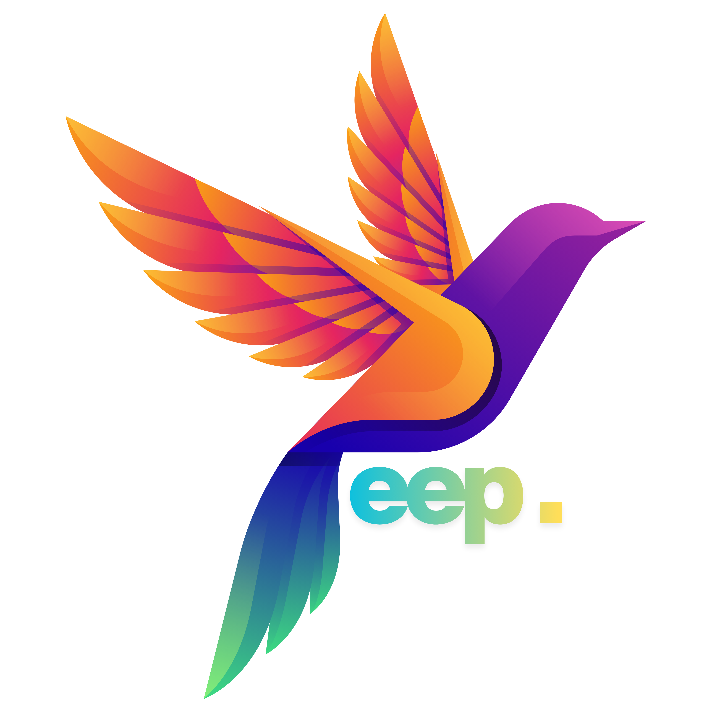
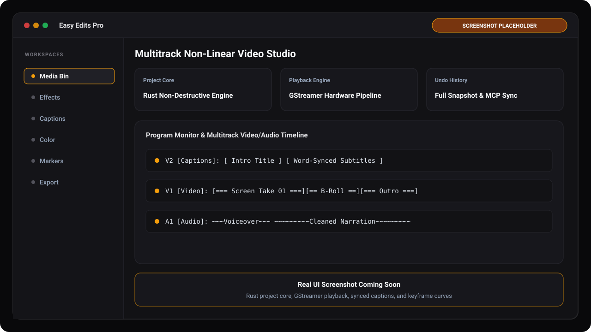
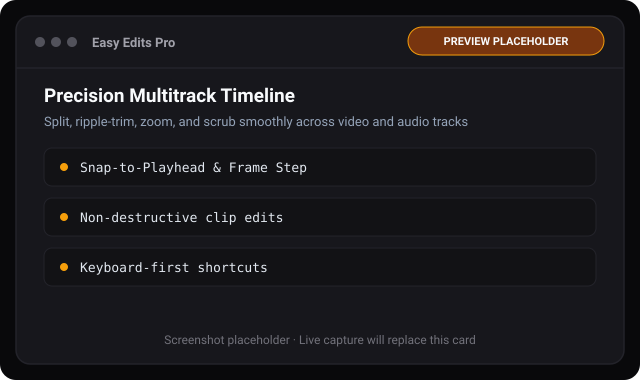
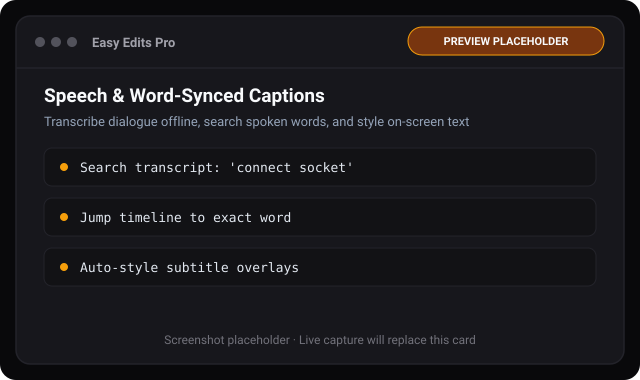
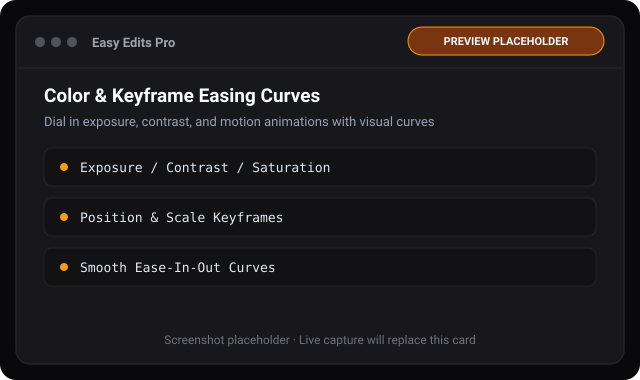
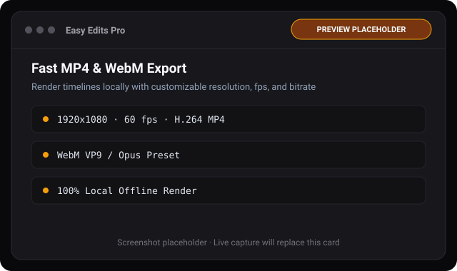
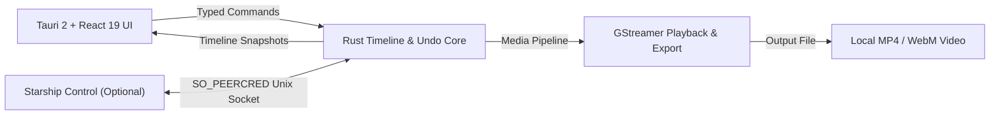

<div align="center">
  <a id="top"></a>
  <p>
    
  </p>

  <h1>Easy Edits Pro</h1>

  <h3>Fast, non-destructive video editing built natively for Linux</h3>

  <p>
    Cut multitrack videos, sync word-level captions, grade color, animate keyframes, and render MP4 or WebM clips completely offline.
  </p>

  <p>
    <a href="https://zvirox.in/projects/eep/">Project Page</a> ·
    <a href="https://zvirox.in/downloads/eep/">Download Packages</a> ·
    <a href="https://github.com/zvirox/easy-edits-pro/releases">GitHub Releases</a> ·
    <a href="#quick-installation">Quick Install</a> ·
    <a href="#key-features">Features</a> ·
    <a href="#starship-control-integration">Starship Control</a> ·
    <a href="#maintainer-and-ecosystem">Maintainer</a> ·
    <a href="#frequently-asked-questions">FAQ</a>
  </p>

  <p>
    <a href="https://zvirox.in/downloads/eep/">
      
    </a>
    <a href="https://github.com/zvirox/easy-edits-pro/actions/workflows/ci.yml">
      
    </a>
    <a href="LICENSE">
      
    </a>
    
    
  </p>

  <table>
    <tr>
      <td align="right"><b>Start</b></td>
      <td align="center"><a href="#what-is-easy-edits-pro">What It Is</a></td>
      <td align="center"><a href="#workspace-previews">Previews</a></td>
      <td align="center"><a href="#quick-installation">Install</a></td>
    </tr>
    <tr>
      <td align="right"><b>Features</b></td>
      <td align="center"><a href="#key-features">Key Capabilities</a></td>
      <td align="center"><a href="#how-the-editor-works">Architecture</a></td>
      <td align="center"><a href="#tech-stack">Tech Stack</a></td>
    </tr>
    <tr>
      <td align="right"><b>Automation</b></td>
      <td align="center"><a href="#starship-control-integration">Starship Control</a></td>
      <td align="center"><a href="#real-world-use-cases">Use Cases</a></td>
      <td align="center"><a href="#how-connection-works">Socket Setup</a></td>
    </tr>
    <tr>
      <td align="right"><b>Community</b></td>
      <td align="center"><a href="#frequently-asked-questions">FAQ</a></td>
      <td align="center"><a href="#maintainer-and-ecosystem">Maintainer</a></td>
      <td align="center"><a href="#license">License</a></td>
    </tr>
  </table>
</div>

<br />

<p align="center">
  
  <br />
  <sub><b>Screenshot placeholder.</b> Easy Edits Pro workspace showing Media Bin, Program Monitor, Color Inspector, and multitrack timeline.</sub>
</p>

---

## What is Easy Edits Pro?

Creators and developers on Linux often have to pick between dated open-source editors or browser subscriptions that upload private raw footage to outside servers. Simple screencasts, walkthroughs, and social clips deserve a responsive native editor that runs straight on your computer.

Easy Edits Pro combines a pure Rust project core and GStreamer media pipeline with a calm matte-dark interface. All project state lives safely in Rust so cuts, volume curves, overlays, and grades stay non-destructive with instant undo and redo. Everything happens offline on your own hardware.

---

## Workspace Previews

<table>
  <tr>
    <td width="50%" valign="top">
      <br />
      <strong>Precision Multitrack Timeline</strong><br />
      Arrange multiple video and audio lanes with smooth scrubbing, frame stepping, splitting, ripple trim, and zooming.
    </td>
    <td width="50%" valign="top">
      <br />
      <strong>Smart Speech and Captions</strong><br />
      Transcribe spoken audio offline, search words to jump across footage, and style crisp on-screen captions.
    </td>
  </tr>
  <tr>
    <td width="50%" valign="top">
      <br />
      <strong>Color and Keyframe Curves</strong><br />
      Fine-tune exposure, contrast, and saturation alongside smooth motion keyframes with custom easing curves.
    </td>
    <td width="50%" valign="top">
      <br />
      <strong>Fast Local Export</strong><br />
      Render standard MP4 (H.264 / AAC) and WebM videos locally using GStreamer and your hardware codecs.
    </td>
  </tr>
</table>

---

## Key Features

- **Rust-Owned Project Core**: Your timeline, snapshots, and undo history are managed cleanly inside Rust. Source files on disk remain completely untouched during editing.
- **Word-Level Transcript Navigation**: Automatically turn dialogue into searchable text so clicking any word moves your playhead straight to that moment.
- **Visual Color and Motion Tools**: Adjust exposure, saturation, and contrast, and animate clip positions or scale with customizable easing curves.
- **GStreamer Hardware Rendering**: Smooth timeline previews and hardware-ready MP4 and WebM output with full resolution and bitrate control.
- **Locked Linear Matte Interface**: Built for long editing sessions with dark and light matte themes toggled cleanly from the title bar, `1px` crisp borders, zero blurry glass, and zero overlays over your video canvas.
- **Full Command Catalogue**: Every timeline action maps to a documented command, giving you reliable keyboard shortcuts and optional AI automation.

---

## How the Editor Works

Easy Edits Pro separates UI rendering from timeline state and GStreamer playback so heavy decoding never blocks your editing controls.



| Format / Capability | Details | Notes |
| :--- | :--- | :--- |
| **Video Tracks** | Multi-track timeline | Split, ripple trim, zoom, and keyframes |
| **Captions & Speech** | Offline speech sync | Word-level timestamps and styled captions |
| **Color Controls** | Exposure, contrast, saturation | Applied non-destructively per clip |
| **Export Codecs** | MP4 (H.264 / AAC) and WebM | Local rendering via GStreamer |

---

## Starship Control Integration

Easy Edits Pro works completely as an independent video editor. You can import clips, cut timelines, add captions, grade color, and export finished videos with zero outside dependencies.

When you want intelligent timeline help, Easy Edits Pro pairs directly with [Starship Control](https://github.com/zvirox/starship-control) ([Releases](https://github.com/zvirox/starship-control/releases)), the optional Linux desktop AI assistant.

### Why It Exists

Rough-cutting long screen captures, deleting dead pauses, and lining up separate voiceover takes can eat up hours of manual clicking. Connecting Easy Edits Pro to Starship Control lets you hand off repetitive timeline tasks in simple English while keeping full editorial sign-off and instant `Ctrl+Z` undo.

### Real-World Use Cases

- **Automated Silence Removal**: Ask Starship Control *"Scan this timeline for pauses longer than one second and trim them cleanly."*
- **Multi-App Studio Assembly**: Request *"Import my latest recording from Screen Studio Pro and my clean voiceover from Audio Labs Pro, sync them, and set up a 1080p timeline."*
- **Chapter Marker Setup**: Tell the agent *"Read the dialogue transcript and add named markers at each topic shift."*

### How Connection Works

Setup is automatic when both programs run:

1. **Local Discovery**: When Easy Edits Pro starts, it saves its plugin manifest to `$XDG_DATA_HOME/starship/plugins/eep.json`.
2. **Private Unix Socket**: Commands travel through `$XDG_RUNTIME_DIR/starship/bridges/eep.sock`.
3. **Kernel User Verification**: The socket verifies Linux peer credentials (`SO_PEERCRED`) on every message. Only apps running under your exact Linux user account can send commands. Your footage stays strictly local.
4. **Instant Control**: Press `Super+Shift+Space` to summon Starship Control and request edits right away. For downloads and setup guides, visit the [Starship Control repository](https://github.com/zvirox/starship-control) and [releases](https://github.com/zvirox/starship-control/releases).

---

## Quick Installation

Prebuilt Linux packages and checksum files are published on the [Releases page](https://github.com/zvirox/easy-edits-pro/releases).

| Distribution | Package Format | Install Command |
| :--- | :--- | :--- |
| **Debian / Ubuntu / Pop!_OS / Mint** | `.deb` | `sudo apt install ./easy-edits-pro_*_amd64.deb` |
| **Fedora / RHEL / openSUSE** | `.rpm` | `sudo dnf install ./easy-edits-pro-*.x86_64.rpm` |
| **Arch Linux / Manjaro / CachyOS** | `.pkg.tar.zst` | `sudo pacman -U ./easy-edits-pro-*-x86_64.pkg.tar.zst` |

<details>
<summary><strong>Verify Checksums and Build From Source</strong></summary>

Verify downloaded files using `SHA256SUMS`:

```bash
sha256sum -c SHA256SUMS --ignore-missing
```

To build directly from source, install Rust stable, Node.js 22+, pnpm, GStreamer libraries (`libgstreamer1.0-dev`, `libgstreamer-plugins-base1.0-dev`), WebKitGTK (`libwebkit2gtk-4.1-dev`), and GTK 3:

```bash
git clone https://github.com/zvirox/easy-edits-pro.git
cd easy-edits-pro
cd apps/saturn-tauri && pnpm install && pnpm build && cd ../..
cargo build --release --manifest-path apps/saturn-tauri/Cargo.toml --target-dir target --features tauri/custom-protocol
```

</details>

Official Linux releases ship exclusively as native `.deb`, `.rpm`, and `.pkg.tar.zst` packages alongside `SHA256SUMS`. Legacy AppImage, Flatpak, tarball, and AUR packages are retired and no longer updated.

---

## Tech Stack

| Layer | Technology | Role |
| :--- | :--- | :--- |
| **Project Engine** | Rust (`saturn-core`, `saturn-commands`) | Non-destructive timeline state, undo snapshots, and command router |
| **Media Pipeline** | GStreamer | Real-time video playback, frame decoding, and MP4/WebM export |
| **Desktop Shell** | Tauri 2 | Custom 40 px frameless title bar, native Linux shell, and filesystem dialogs |
| **Frontend UI** | React 19 + TypeScript + Tailwind CSS v4 | Locked Linear matte components, Inter typography, inspector controls, and timeline canvas |
| **Scopes & State** | Canvas `VideoScopes` + Zustand | Raw waveform/vectorscope/parade/histogram scopes and reactive UI bindings |
| **Automation Bridge** | `starship-plugin` SDK | Local Unix socket tools and Tier 2 editing approvals |

---

## Frequently Asked Questions

**Does Easy Edits Pro need an internet connection?**
No. Video importing, timeline editing, captions, color grading, and rendering all run offline on your machine.

**Is Starship Control required to edit videos?**
No. Easy Edits Pro has a complete visual user interface with full mouse and keyboard editing tools. Starship Control is an optional add-on for automated workflows.

**Can I undo changes made by Starship Control?**
Yes. Every automated edit runs through the same Rust undo history, so pressing `Ctrl+Z` reverses it cleanly.

**What formats can I export?**
Easy Edits Pro exports standard MP4 (H.264 / AAC) and WebM videos with custom resolution, frame rate, and bitrate settings.

---

## Maintainer and Ecosystem

<p align="center">
  <a href="https://www.zvirox.in">
    
  </a>
</p>

<p align="center">
  <strong>Prakashpuri Gauswami (<a href="https://github.com/zvirox">@zvirox</a>)</strong><br />
  Cybersecurity Analyst &amp; SOC Practitioner · Agentic AI Builder · Blue Team &amp; SIEM · Patan, Gujarat, India
</p>

<p align="center">
  <a href="https://github.com/sponsors/zvirox">
    
  </a>
  <a href="https://ko-fi.com/zvirox">
    
  </a>
</p>

I build local-first open-source Linux and Android tools under **Zvirox**. Writing real software helps me study system boundaries and security architecture hands-on while giving creators and Linux users fast desktop tools free from subscriptions and telemetry.

### Connect and Support

- **GitHub Profile**: [github.com/zvirox](https://github.com/zvirox)
- **Website**: [www.zvirox.in](https://www.zvirox.in)
- **Email**: [info@zvirox.in](mailto:info@zvirox.in)
- **Sponsor**: [GitHub Sponsors](https://github.com/sponsors/zvirox) · [Ko-fi](https://ko-fi.com/zvirox)
- **Socials**: [LinkedIn (`in/plgsevala`)](https://www.linkedin.com/in/plgsevala) · [YouTube (`@zvirox_in`)](https://www.youtube.com/@zvirox_in) · [Instagram (`plg.sevala`)](https://www.instagram.com/plg.sevala) · [Facebook (`plg.sevala`)](https://www.facebook.com/plg.sevala)

### Zvirox App Suite (Open-Source Project List)

All six applications in the Zvirox desktop suite work standalone and connect together through Starship Control:

| Logo | Application | Purpose | Repository | Download & Project |
| :---: | :--- | :--- | :--- | :--- |
|  | **[Starship Control](https://zvirox.in/projects/sc/)** | Local-first AI desktop cockpit and floating HUD | [github.com/zvirox/starship-control](https://github.com/zvirox/starship-control) | [Download](https://zvirox.in/downloads/sc/) · [Releases](https://github.com/zvirox/starship-control/releases) |
|  | **[Screen Studio Pro](https://zvirox.in/projects/ssp/)** | Wayland and X11 screen recorder with PipeWire | [github.com/zvirox/screen-studio-pro](https://github.com/zvirox/screen-studio-pro) | [Download](https://zvirox.in/downloads/ssp/) · [Releases](https://github.com/zvirox/screen-studio-pro/releases) |
|  | **[Easy Edits Pro](https://zvirox.in/projects/eep/)** | Non-destructive multitrack video editor | [github.com/zvirox/easy-edits-pro](https://github.com/zvirox/easy-edits-pro) | [Download](https://zvirox.in/downloads/eep/) · [Releases](https://github.com/zvirox/easy-edits-pro/releases) |
|  | **[Audio Labs Pro](https://zvirox.in/projects/alp/)** | Offline voice studio and multitrack audio editor | [github.com/zvirox/audio-labs-pro](https://github.com/zvirox/audio-labs-pro) | [Download](https://zvirox.in/downloads/alp/) · [Releases](https://github.com/zvirox/audio-labs-pro/releases) |
|  | **[Agentic Tuneup Pro](https://zvirox.in/projects/atp/)** | Safety-first disk cleaner and system optimizer | [github.com/zvirox/agentic-tuneup-pro](https://github.com/zvirox/agentic-tuneup-pro) | [Download](https://zvirox.in/downloads/atp/) · [Releases](https://github.com/zvirox/agentic-tuneup-pro/releases) |
|  | **[Net Watch Pro](https://zvirox.in/projects/nwp/)** | Real-time network speed and per-app data tracker | [github.com/zvirox/net-watch-pro](https://github.com/zvirox/net-watch-pro) | [Download](https://zvirox.in/downloads/nwp/) · [Releases](https://github.com/zvirox/net-watch-pro/releases) |
| - | **[Your TV Friend](https://zvirox.in/projects/ytf/)** | Android TV non-destructive debloater and Your UI launcher | [github.com/zvirox/your-tv-friend](https://github.com/zvirox/your-tv-friend) | [Download APK](https://zvirox.in/downloads/ytf/) · [Releases](https://github.com/zvirox/your-tv-friend/releases) |

---

## Star History

<p align="center">
  <a href="https://www.star-history.com/#zvirox/easy-edits-pro&Date">
    <picture>
      <source media="(prefers-color-scheme: dark)" srcset="https://api.star-history.com/svg?repos=zvirox/easy-edits-pro&type=Date&theme=dark" />
      <source media="(prefers-color-scheme: light)" srcset="https://api.star-history.com/svg?repos=zvirox/easy-edits-pro&type=Date" />
      
    </picture>
  </a>
</p>

---

## License

Easy Edits Pro is dual-licensed under the [GNU Affero General Public License v3.0](LICENSE) or an optional [Commercial License](LICENSE-COMMERCIAL.md).

<div align="center">
  <br />
  <a href="#top"><strong>Back to top</strong></a> · Built in public by <a href="https://www.zvirox.in">Zvirox</a>
</div>
