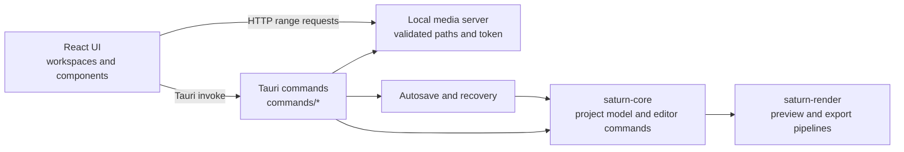

# Architecture

## Runtime path

## Module map

- `apps/saturn-tauri/src/main.rs` owns the Tauri builder, invoke registration,
  setup, and shared app-level helpers.
- `apps/saturn-tauri/src/commands/` groups Tauri commands by domain. `mod.rs`
  re-exports the commands registered with `generate_handler!`.
- `apps/saturn-tauri/src/net.rs` resolves public network targets, rejects
  non-public addresses, pins DNS results, and re-validates manual redirects.
- `apps/saturn-tauri/src/media_server.rs` streams only canonical, allow-listed
  media paths and authenticates requests with a per-run token.
- `apps/saturn-tauri/src/recovery.rs` stores and restores project autosaves.
  `register_project_media` is the shared allow-list registration path used by
  project changes, startup, and recovery.
- `crates/saturn-core/` owns project data, command execution, history, and
  timeline operations. `crates/saturn-render/` owns media processing and
  rendering.
- `apps/saturn-tauri/ui/src/app/` contains application hooks; `features` and
  `workspaces` hold UI areas; `engine` contains playback coordination; and
  `utils` holds pure helpers.
- `apps/saturn-tauri/ui/src/style.css` imports the ordered stylesheet sections
  through `styles/index.css`. Preserve the order to keep the existing cascade.

## Adding a Tauri feature

Put the command in the relevant `commands/<domain>.rs` module, re-export it from
`commands/mod.rs`, and register it in `generate_handler!` in `main.rs`. Keep
project mutations in `saturn-core`; the Tauri command should adapt inputs and
outputs and handle app-specific services. Add pure helper tests next to the
module that owns the helper, then run `cargo test --workspace`, `cargo test` in
`apps/saturn-tauri`, and the UI build and tests.

The size check enforces a 1,000-line ceiling for new source files. Four legacy
files remain on the extraction backlog: the main React shell, playback engine,
core command engine, and project schema/migrations.
