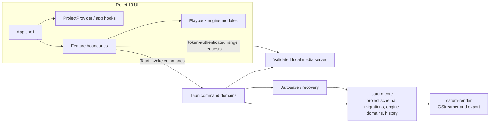

# Architecture

## Runtime data flow

A project mutation flows from a UI feature through the stable Tauri invoke
contract into the domain command dispatcher in `saturn-core`. The core updates
the versioned project model and history; the UI refreshes project state through
`ProjectProvider`. Preview playback resolves allow-listed media through the
local media server and coordinates video decks and audio clocks in the frontend
playback engine. Export work is sent to `saturn-render` through Tauri commands.

## Module map

- `apps/saturn-tauri/src/main.rs` owns the Tauri builder, invoke registration,
  setup, and shared app-level helpers.
- `apps/saturn-tauri/src/commands/` groups Tauri commands by domain. `mod.rs`
  re-exports the commands registered with `generate_handler!`.
- `apps/saturn-tauri/src/state.rs` owns shared application state.
- `apps/saturn-tauri/src/net.rs` resolves public network targets, rejects
  non-public addresses, pins DNS results, and re-validates manual redirects.
- `apps/saturn-tauri/src/media_server.rs` streams only canonical, allow-listed
  media paths and authenticates requests with a per-run token.
- `apps/saturn-tauri/src/recovery.rs` stores and restores project autosaves.
  `register_project_media` is the shared allow-list registration path used by
  project changes, startup, and recovery.
- `crates/saturn-core/src/project/` separates schema domains, migrations, and
  project I/O. `crates/saturn-core/src/engine/` separates command domains,
  helpers, parameter types, history, and tests. Keep project serialization and
  public command names stable when extending these modules.
- `crates/saturn-render/` owns media processing and rendering.
- `apps/saturn-tauri/ui/src/app/` owns project context and focused hooks such as
  recovery, jobs, and playback. `features/` provides UI-facing boundaries for
  menubar, welcome, media pool, inspector, preview, timeline, and export.
  Established screen implementations remain in `workspaces/` while extraction
  continues; import them through feature entry points.
- `apps/saturn-tauri/ui/src/engine/playback/` owns the audio clock, media URL
  resolution, scheduling, interpolation, effects, and playback types. The
  legacy `playbackEngine.ts` path re-exports this public API.
- `apps/saturn-tauri/ui/src/style.css` imports the ordered stylesheet sections
  through `styles/index.css`. Preserve that order to keep the existing cascade.

## Source size guardrails

New `.rs`, `.ts`, `.tsx`, and `.css` source files must stay at or below 800
lines; target under 500 where the domain allows it. Run
`pnpm --dir apps/saturn-tauri check:source-size` before submitting. The script
fails for newly oversized files and reports a small explicit legacy extraction
backlog. `ui/src/App.tsx`, Fairlight and Keyframes workspace files, and
`saturn-core/src/interop.rs` remain on that backlog; reduce it as those domains
are extracted.

## Adding a Tauri feature

Put the command in the relevant `commands/<domain>.rs` module, re-export it from
`commands/mod.rs`, and register it in `generate_handler!` in `main.rs`. Keep
project mutations in `saturn-core`; the Tauri command should adapt inputs and
outputs and handle app-specific services. Preserve existing `invoke("...")`
command strings and project file compatibility. Add pure helper tests next to
the module that owns the helper, then run Rust tests, the UI build and tests, and
the source-size check.
