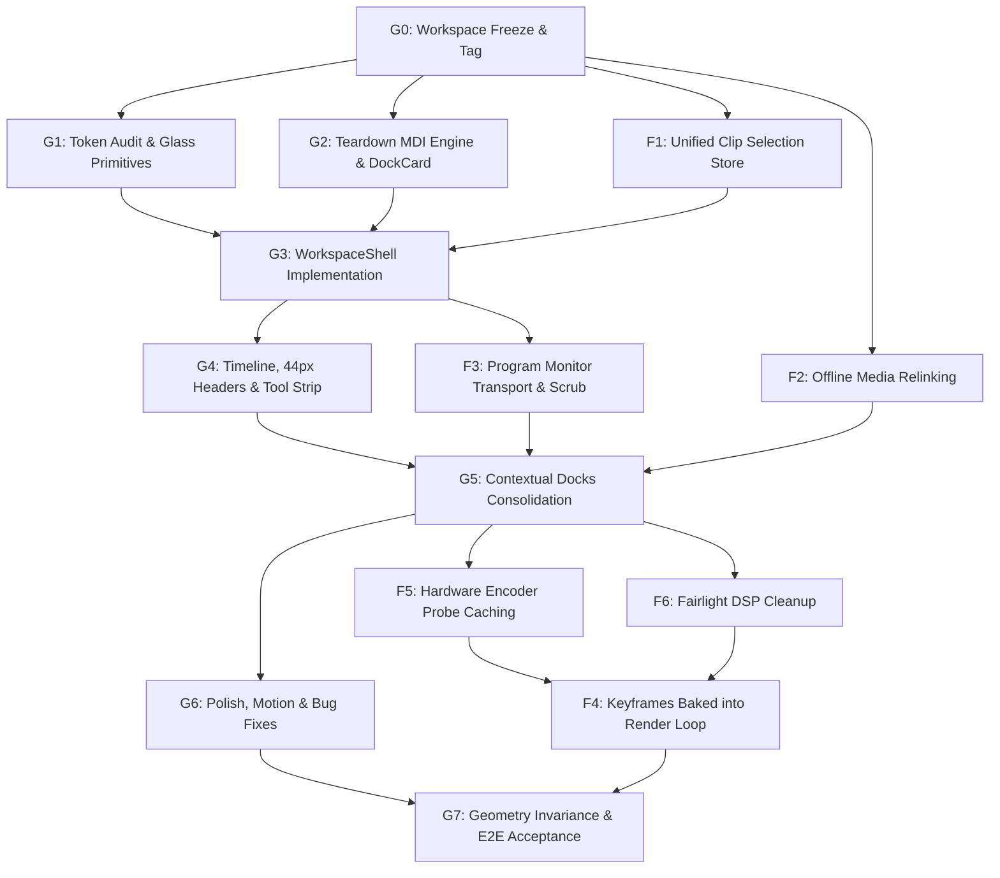

# Easy Edits Pro — Master Delivery & UI Overhaul Plan

**Updated:** 2026-10-23  
**Status source:** Command catalogue generates [PARITY.md](PARITY.md); GitHub Actions is the source for CI and packaging status.

This document serves as the authoritative, forward-looking plan for Easy Edits Pro (EEP). It incorporates the **Executive Architectural Diagnosis**, the **Motrix + FilmCraft Target Hybrid Architecture**, the **UI Correction Plan v4 (Fixed Glass Cards & Persistent 2-Row Viewport)**, and the **Functional Reliability Workstreams (F1–F6)** while resolving all prior roadmap and styling conflicts.

---

## 1. Scope, Design Decisions & Conflict Resolutions

### Core Architectural Decisions

| Decision | Rationale | Resolution / Conflict Elimination |
|---|---|---|
| **Fixed Glass Cards; Zero Window Dragging** | "Floating" is purely visual glass elevation (borders, inner highlight, soft shadows over a frosted, tinted stage). Prior automated development mistakenly implemented a free-floating Multiple Document Interface (MDI) window manager. | **Delete the MDI floating engine** (`FloatingPanel.tsx`, `PanelHost.tsx`, `docking.ts`, `snapping.ts`, `zOrder.ts`, restore pill bar). Panels never detach, drag, pin, minimize, or close. |
| **Existing Colors Are Final & Locked** | The existing plum/magenta glass palette, ambient stage gradients, text, and accent tokens are fully locked and calibrated to WCAG AA contrast gates. | **Reject the PDF's proposed slate color shift** (`rgba(22, 22, 28, 0.78)` / `#110d18`). All surfaces use existing tokens from `00-tokens-glass.css`. Only shape, gap, and elevation tokens are added (`--gap: 12px`, `--radius: 16px`, `--radius-sm: 10px`, `--card-inset`). |
| **Persistent 2-Row NLE Skeleton Across Workspaces** | Switching workspace tabs previously unmounted the editor and mounted isolated full-screen pages with synthetic "SEQUENCE CLIPS REEL" boxes, breaking timeline context. | **Implement a single unified `WorkspaceShell`**. Top-Center Program Monitor, Bottom-Left Toolbox, Bottom-Center Multi-Track Timeline, and Bottom-Right Audio Meter stay permanently locked across all workspaces. Workspaces only swap contextual dock tabs (Dock L / Dock R) and column ratio presets. |
| **Compact 44px Track Headers** | Track headers were bloated to 150px height by horizontal VOL and PAN range sliders, restricting the timeline to a single visible track. | **Standardize on FilmCraft's compact 44px track headers** (Source Patch pill, Lock, Target pill, Name, M/S, Visibility eye). Move per-track gain/pan sliders into the Inspector and Audio Mixer. |
| **Validate on Development Laptop First** | Local testing on the development laptop is the only verified baseline. Avoid cross-hardware claims without local reproduction. | Host path uses software H.264/x264 fallback as ground truth; hardware acceleration detection (nvenc, vaapi, videotoolbox, qsv) is cached asynchronously. |
| **Authoritative Rust Engine Core** | Project state, history, undo/redo, timeline mutations, and export pipelines remain strictly in Rust (`crates/saturn-*`). | React UI and MCP services submit structured commands and render snapshots; client state is never forked. |

---

## 2. Locked Design System & Token Architecture

All UI components must consume the existing design tokens in `00-tokens-glass.css` and `01-editor.css`. **No color value may be modified or added.**

### 2.1 Final Surface & Color Tokens

```css
:root {
  /* STAGE BACKGROUND: Locked radial glow + linear backdrop */
  --bg-stage:
    radial-gradient(48vw 42vh at 18% 22%, rgba(255, 92, 148, 0.2), transparent 62%),
    radial-gradient(42vw 46vh at 82% 74%, rgba(88, 132, 255, 0.18), transparent 64%),
    radial-gradient(36vw 32vh at 62% 18%, rgba(255, 184, 92, 0.1), transparent 60%),
    linear-gradient(160deg, #170c16 0%, #0b060a 54%, #120a14 100%);

  /* GLASS SURFACES: Locked existing tokens */
  --glass-l1: rgba(24, 13, 23, 0.56);
  --glass-border: rgba(244, 215, 235, 0.14);
  --glass-highlight: rgba(255, 255, 255, 0.08);
  --glass-shadow: 0 18px 48px rgba(0, 0, 0, 0.45);
  --blur-l2: 14px;
  --glass-saturate: 145%;

  /* TYPOGRAPHY: Locked existing text tokens */
  --text-primary: #faf2f7;
  --text-secondary: #d4bccf;
  --text-muted: #a890a0;

  /* ACCENT TOKENS */
  --accent-text: #f472b6;
  --accent-primary: #9f1249;
  --accent-text-violet: #c084fc;
  --ring: rgba(244, 114, 182, 0.55);

  /* TRACK & STEM TOKENS */
  --video: #7ad0ff;
  --audio: #6be0a8;
  --gfx: #ffb35c;

  /* SHAPE & ELEVATION: New structural tokens only (No new colors) */
  --gap: 12px;
  --radius: 16px;
  --radius-sm: 10px;
  --card-inset: rgba(255, 255, 255, 0.045);
}

/* Glass Card Primitive (Desktop-Kit Pattern) */
.glass {
  background: var(--glass-l1);
  border: 1px solid var(--glass-border);
  border-radius: var(--radius);
  box-shadow: inset 0 1px 0 var(--glass-highlight), var(--glass-shadow);
  backdrop-filter: blur(var(--blur-l2)) saturate(var(--glass-saturate));
  -webkit-backdrop-filter: blur(var(--blur-l2)) saturate(var(--glass-saturate));
  display: flex;
  flex-direction: column;
  min-width: 0;
  min-height: 0;
  overflow: hidden;
}
```

> [!IMPORTANT]
> **GPU Compositor Safety Rule:** `backdrop-filter` is applied strictly to non-overlapping `.glass` cards over the static root stage. It must **never** be placed over the active `<video>` canvas or wgpu preview surface, ensuring zero blur-kernel re-evaluations during 60 FPS playback.

---

## 3. Persistent 2-Row NLE Viewport Architecture

```
┌────────────────────────────────────────────────────────────────────────────────────────────────────────┐
│                                AppHeader & Global Menus (46px)                                         │
├───────────────────────────────┬────────────────────────────────────────┬───────────────────────────────┤
│   Top-Left Contextual Dock    │   Top-Center Persistent Program        │   Right Contextual Dock       │
│   minmax(260px, 24% - 28%)    │   Monitor (1fr)                        │   minmax(260px, 24%)          │
│   (Swappable Tabs)            │   (GPU Canvas + Scrub + Transport)     │   (Swappable Tabs)            │
├─────┬─────────────────────────┴────────────────────────────────────────┴───────────────────────┬───────┤
│Tool │  Bottom-Center Multi-Track Timeline (1fr)                                                │Master │
│Strip│  (Compact 44px Track Headers, Sequence Tabs, Grouped Toolbar, Playhead, Lanes)          │Meter  │
│52px │                                                                                          │92px   │
├─────┴──────────────────────────────────────────────────────────────────────────────────────────┴───────┤
│                                StatusBar & Telemetry (30px)                                            │
└────────────────────────────────────────────────────────────────────────────────────────────────────────┘
```

### Contextual Dock Tab Mapping per Workspace

The 4-zone lower row (Toolbox, Timeline, Audio Meter, Status Bar) and the Top-Center Program Monitor **never move or unmount**. Clicking workspace tabs changes only the docked tabs in Dock L and Dock R, along with column width presets:

| Workspace Mode | Top-Left Contextual Dock | Top-Center Monitor | Right Contextual Dock | Bottom Row (Tools + Timeline + Meter) |
|---|---|---|---|---|
| **Edit** | Project · Media Browser · Effects | Persistent Program Monitor | Inspector · Titles · Markers | Persistent 4-Zone Bottom Row |
| **Assembly** | Project · Markers | Persistent Program Monitor | Source Monitor · Inspector | Persistent 4-Zone Bottom Row |
| **Color** | Scopes · Project Media | Persistent Program Monitor | Color Wheels · Curves · HSL · Primary Sliders | Persistent 4-Zone Bottom Row |
| **Audio (Fairlight)** | Track DSP Mixer (4-Band EQ, Comp) · Project | Persistent Program Monitor (Picture Sync) | Essential Sound · Channel Strip Rack | Persistent Bottom Row + Expanded Automation Lanes |
| **Captions & Graphics** | Text (Transcript, Captions, Graphics) · Effect Controls | Persistent Program Monitor + Live `CanvasGraphicsLayer` | Essential Graphics Template Browser · Title/Subtitle Inspector | Persistent 4-Zone Bottom Row |
| **Effects** | Effect Controls (Active Stack, AI Matting) · Source | Persistent Program Monitor | Effects Library (Presets, Audio FX, Video FX) · Essential Graphics | Persistent 4-Zone Bottom Row |
| **Curves (Keyframes)**| Keyframe Bezier Curve Editor · Source | Persistent Program Monitor | Interpolation Style & Tangent Handles (Linear, Ease, Bezier) | Persistent 4-Zone Bottom Row |
| **Fusion** | Node Graph Palette & Node Inspector | Fusion Node Graph Canvas (Tabbed with Program Monitor) | Node Parameters & Routing Sockets | Persistent 4-Zone Bottom Row |
| **Deliver (Export)** | 1-Click Delivery Presets · Export Settings | Program Monitor (In/Out Render Range Scrub) | Batch Render Queue · Timeline Interchange (FCPXML, EDL, OTIO) | Persistent 4-Zone Bottom Row |

---

## 4. Teardown of MDI Window Manager

The following legacy window-management files, state stores, and styles are to be completely removed:

* `apps/saturn-tauri/ui/src/features/panels/FloatingPanel.tsx`
* `apps/saturn-tauri/ui/src/features/panels/PanelHost.tsx`
* `apps/saturn-tauri/ui/src/features/panels/docking.ts` (and `docking.test.ts`)
* `apps/saturn-tauri/ui/src/features/panels/snapping.ts` (and `snapping.test.ts`)
* `apps/saturn-tauri/ui/src/features/panels/layouts.ts`
* `apps/saturn-tauri/ui/src/features/panels/presets.ts`
* `apps/saturn-tauri/ui/src/features/panels/presetStore.ts` (and `presetStore.test.ts`)
* `apps/saturn-tauri/ui/src/features/panels/usePanelLayout.ts`
* `apps/saturn-tauri/ui/src/features/panels/usePanelDrag.ts`
* `apps/saturn-tauri/ui/src/features/panels/usePanelResize.ts`
* `apps/saturn-tauri/ui/src/features/panels/zOrder.ts` (and `zOrder.test.ts`)
* `apps/saturn-tauri/ui/src/features/panels/LayoutPresetsDialog.tsx`
* `apps/saturn-tauri/ui/src/styles/140-panels.css` and `171-layout-presets.css`

### Replacement: Stationary `<DockCard>` Primitive

```tsx
export interface TabDefinition {
  id: string;
  title: string;
  render: () => React.ReactNode;
}

export function DockCard({ id, tabs, activeTabId, onSelectTab }: DockCardProps) {
  const active = tabs.find(t => t.id === activeTabId) ?? tabs[0];
  return (
    <section className="glass" id={id}>
      <div className="card-h">
        {tabs.map(tab => (
          <button
            key={tab.id}
            role="tab"
            aria-selected={tab.id === active.id}
            className="tab"
            onClick={() => onSelectTab(tab.id)}
          >
            {tab.title}
          </button>
        ))}
      </div>
      <div className="card-b">{active.render()}</div>
    </section>
  );
}
```

* All 📌 (Pin), - (Minimize), and X (Close) buttons are deleted from panel headers.
* The bottom-right floating restore pill bar (`PANELS | Markers | Video Scopes | Reset layout`) is removed.
* Stale localStorage keys (`easy-edits-pro.panel-layout.*`) are pruned on startup.

---

## 5. Timeline, Track Headers & Toolbox Specification

### 5.1 Compact 44px Track Headers

* Track header height is locked to **44px** (eliminating the 150px bloat).
* **Video Row Anatomy (44px):** `[Source Patch V1] [Lock 🔒] [Target V1] [Track Name] [Sync Lock] [Visibility 👁]`
* **Audio Row Anatomy (44px):** `[Source Patch A1] [Lock 🔒] [Target A1] [Track Name] [Sync Lock] [Mute M] [Solo S] [Voiceover 🎙] [Keyframe ◆]`
* Master Mix footer terminates the audio block with `Mix 0.0`.
* Horizontal VOL and PAN sliders are completely removed from the track header and relocated to the Inspector and Audio Clip Mixer.

### 5.2 Grouped Timeline Toolbar (40px)

Divided by hairlines into 4 clear functional groups:
1. **Edit Modes:** Snap (🧲) · Linked Selection · Ripple Edit
2. **Marking:** Add Marker (M) · Mark In (I) · Mark Out (O)
3. **Tracks:** Add Track (+)
4. **Zoom Navigation:** Zoom Out · Zoom Range Slider · Zoom In

### 5.3 Vertical Tool Strip (52px Card)

Single-column vertical card positioned between the Media Browser and Timeline:
* **Group 1:** Selection (`V`) · Track Select Forward (`A`)
* **Group 2:** Ripple Edit (`B`) · Razor / Blade (`C`) · Slip (`Y`)
* **Group 3:** Hand / Pan (`H`) · Text (`T`)

### 5.4 Master Audio Meter (92px Card)

Flanks the timeline on the far right:
* Dual-channel vertical peak level bars (0 to -57 dB) with green/amber/red grading.
* Live EBU R128 loudness telemetry: Momentary (M), Short-Term (S), Integrated (I), True Peak (TP).

---

## 6. Phase-Wise Implementation Roadmap

Work is organized into two concurrent tracks: **UI Overhaul (Workstream G)** and **Functional Dependability (Workstream F)**.



### UI Workstream G

* **G0 — Codebase Freeze & Safety Tag:** Tag current commit `pre-glass-cards`.
* **G1 — Token Verification & Glass Card Primitives:** Register `--gap`, `--radius`, `--radius-sm`, and `--card-inset` in `00-tokens-glass.css` without modifying any color value. Verify against `pnpm check:contrast` and `pnpm check:tokens`.
* **G2 — MDI Engine Teardown:** Remove all 12 floating panel engine files, purge `save_panel_layout` commands, and establish `<DockCard>`.
* **G3 — Unified `WorkspaceShell` Grid:** Implement the persistent 2-row CSS grid in `WorkspaceShell.tsx`. Route Edit, Assembly, Color, Audio, Captions, Effects, Curves, Fusion, and Deliver as dock tab presets. Delete "SEQUENCE CLIPS REEL" and "Back to Edit" buttons.
* **G4 — Timeline, 44px Track Headers & Tool Strip:** Implement compact track rows in `TimelineTrackLane.tsx`, 52px single-column vertical toolbox, grouped 40px timeline toolbar, and 92px master meter.
* **G5 — Contextual Workspaces Docking:** Mount Color Scopes, Fairlight DSP racks, Fusion Canvas tab, and Deliver Export Settings into Dock L and Dock R without unmounting the Program Monitor or Timeline.
  * **User decision (2026-10-23):** Deliver is REVERTED to the previous
    full-page ExportWorkspace (as of `c9ecc2f`, restored verbatim) and routed
    before the shell. The Deliver page is intentionally frozen — do not dock
    it, do not modify its layout. Geometry invariance now covers the seven
    shell modes; deliver gets its own mount/status-bar/menu assert in
    `geometry.mjs`.
* **G6 — UI Polish & Bug Fixes:** 
  1. Fix top menu overflow below 1300px.
  2. Resolve all missing SVG icons in `Icon.tsx`.
  3. Ensure status bar is never obscured.
  4. Implement smooth 220ms card mount transitions respecting `prefers-reduced-motion`.
* **G7 — Invariance Tests & E2E Validation:** Execute Geometry Invariance tests and Playwright smoke verification.
  * **Done (2026-10-23):** the plan-v4 §9 acceptance is closed out — the
    geometry-invariance walk (all eight modes, remount probes) now runs at
    **1920×1080, 1600×900 and 1280×720**, the §9 **no-overlap test** asserts no
    two card surfaces intersect in any mode or viewport, and the status-bar +
    menu-overflow invariants hold throughout. §7.4's bus-assign minimum width
    is fixed; §7.4's automation pills and §7.6 were already resolved. §7.5
    (Program "Offline media – Relink" card) is verified **missing** and folded
    into F2. Plan v4 debt from this block is fully resolved (2026-10-23): the
    typed per-workspace column-ratio table
    (`workspaces/columnRatios.ts` — plan §5's fixed presets, `edit
    [28, 48, 24]`, `color [34, 42, 24]`, `audio [40, 36, 24]`, edit split as
    the fallback) drives `WorkspaceShell`'s dock columns through CSS custom
    properties; §5's responsive regime collapses the right dock card across
    1100–1280 (boundary-mounts at 1281px); and the F workstream (F1–F6) is
    complete. The geometry harness now encodes the §5 contract directly:
    row 2 never moves, the right dock stays 24%, modes sharing the edit
    preset keep the monitor pixel-identical, color/audio visibly re-ratio,
    and inside the collapse band the fixed two-track shell is invariant.

### Functional Workstream F

* **F1 — Single Reactive Clip Selection Store:** Unify selection across Timeline, Inspector, Effects, Color, and Curves. Auto-select the first clip on V1 upon sequence load.
  * **Done (2026-10-23):** `app/selectionStore.ts` is the single reactive
    source (store-backed hook; docks and the app header read it directly via
    `useClipSelection`, the prop-drilled `selectedClip` plumbing into
    InspectorPanel/EffectDockRight/ColorDockRight/KeyframesDockRight/
    CurveSidebar/AppHeader is removed). The dead `selectedClipId` chain is
    deleted, the duplicate `SelectedClip` type is unified on `types.ts`, and
    the first V1 clip is auto-selected once per sequence load.
* **F2 — Media Ingestion & Offline Relinking:** Correct local range stream URLs in `mediaUrl.ts`, ensure `useMediaServer.ts` initializes prior to project recovery, and add a one-click "Relink Media" action in `MediaPanel.tsx`.
  * **Done (2026-10-23):** `useMediaServer` resolves port/token before the
    editor stage mounts (App holds a "Preparing media engine" stage until
    ready), and the router's hardcoded `mediaServerPort: 0` preview stub is
    replaced by the real port - stream URLs were effectively empty for engine
    preview proxies before both fixes. §7.5 lands here: the Program monitor
    shows an "Offline media" card with a working Relink action (engine
    -validated `project.relink_media`) when the visible deck's media is in
    `missingMediaIds`. MediaPanel's one-click relink already existed (M-work).
* **F3 — Program Monitor Transport & Telemetry:** Align transport bar (10 buttons: Add Marker, Mark In/Out, Step, Play, Lift, Extract, Export Frame), blue playhead timecode, Fit zoom dropdown, and resolution divider.
  * **Done (2026-10-23):** Transport grew from 3 to 10 controls: Add Marker
    (`marker.add` at playhead), Mark In/Out (`timeline.set_mark_in/out`),
    Prev/Play/Next, Lift (`sequence.lift`), Extract (`sequence.extract`),
    and Export Frame (`export_frame` Tauri command rendering the frame via
    GES + appsink to a caller-chosen PNG). Lift/Extract run on the marked
    range, need both marks set, and are disabled otherwise. The playhead
    timecode reads in the violet accent token, the monitor header shows a
    resolution divider + `1920×1080 · fps` telemetry, and a Fit/50/100/
    150/200% zoom dropdown letterboxes or scales the monitor content from
    centre (Fit default keeps geometry invariance). New `timeline_edits.rs`
    module hosts the gap-preserving lift semantics (ripple cut logic split
    out of speech.rs), with unit + command-workflow tests for both ops.
* **F4 — Keyframe Render Baking:** Wire `interpolation.ts` keyframe evaluator into `crates/saturn-render/src/lib.rs` export loop, baking transform, opacity, and audio automation into MP4 output.
  * **Done (2026-10-23):** The preview keyframe evaluator (CSS cubic-bezier
    `solveCubicBezier` + `interpolateKeyframe`) is ported 1:1 into Rust
    (`keyframes.rs`, unit-tested against the TS parity values), and a new
    `saturnkfvid` GStreamer base-transform element (`keyframe_element.rs`)
    bakes position/scale/rotation/opacity clip keyframes into exported
    frames: per-buffer PTS sampling over timeline-absolute curves (staged
    per clip key the same way audio automation is), an inverse CSS warp
    around the frame centre (`translate(px) scale(s) rotate(deg)`, origin
    center) with bilinear sampling, transparent output outside the warped
    source bounds, and keyframed straight-alpha output so GES's compositor
    blends correctly. The element attaches as a top effect only on clips
    whose model has visual keyframes, so non-keyframe renders are
    unchanged. Live-pipeline integration tests (`tests/keyframe_video.rs`)
    verify the opacity fade lands ~50% alpha halfway, scale-down leaves
    corners transparent, translate moves the source window, and identity
    payloads stay an opaque pass-through.
* **F5 — Hardware Encoder Probe Optimization:** Run GStreamer hardware encoder detection asynchronously at startup, caching results so the Deliver workspace never stalls.
  * **Done (2026-10-23):** `detect_hardware_encoders()` now probes once per
    process through a `gpu_detect.rs` cache. Startup submits the probe as a
    background job on the existing JobManager (visible in the job drawer,
    kind `encoder-probe`), so GStreamer initialization never runs on the UI
    path; the result is pushed to the UI over `encoder_capabilities_ready`
    and `detect_encoder_capabilities` returns the cached answer once warm.
    The new `useEncoderCapabilities` hook replaces the hardcoded
    `encoderInfo={null}` that kept the Deliver workspace on its "Probing..."
    placeholder forever, so the hardware-encoder readout (VA-API/NVENC/QSV
    vs. the CPU fallback list) is live. Unit-tested: the cache runs the
    probe exactly once.
* **F6 — Fairlight Plugin Host Cleanup:** Clean up placeholder slots; ensure active audio tracks bind directly to 4-band parametric EQ and compressor.
  * **Done (2026-10-23):** The fake "PLUGIN SLOTS · BUILT-IN EFFECT HOST
    PENDING" rack (four named saved-slot plugins with empty `params: {}`
    that bound to no DSP) is removed from the Fairlight channel strips, and
    the dead plumbing behind it — `track.add_audio_plugin` /
    `track.toggle_audio_plugin` commands (both unshipped), the
    `AudioPluginInstance` schema type, the `Track.plugins` field, and the
    `addTrackPlugin`/`toggleTrackPlugin` UI wiring — is gone (catalogue now
    213 commands / 115 shipped). Active audio tracks bind directly to a real
    4-band parametric EQ end-to-end: the schema gains the high-mid bell
    (`eq_highmid_gain`, 2.5 kHz, serde-defaulted so older projects keep
    their sound), the preview chain gains a fourth WebAudio peaking node,
    the DSP rack gains the fourth band plus a 4-anchor response curve, and
    the export path now honors all four bands. That export fix also repairs
    a latent bug: `equalizer-3bands` was driven with a nonexistent `band3`
    property, so GES silently dropped the whole track EQ from every export;
    the effect strings are now a unit-tested pure helper (`band0/band1/
    band2` on equalizer-3bands plus `equalizer-10bands band6` for the
    bell), and EQ attach failures propagate instead of vanishing.

### Parity fulfilment workstream (post-alpha.4)

* **P1 — Clip + timeline Tier-1 audit & flip (Done 2026-10-24, `2e74b35`,
  shipped in 0.1.0-alpha.5):** Audited all 42 planned `clip.*` / `timeline.*`
  commands against the verified-before-done rule (engine dispatch arm, UI
  affordance, test). 30 already met the rule and were flipped to shipped:
  10 clip commands (color, keyframes, effects, color wheels, speed ramp,
  motion blur) and 20 timeline commands (add/move/trim/slip/roll/slide,
  transitions, titles, tracks, track groups, compound clips, link/unlink,
  ripple-delete-gap). Added the missing `remove_keyframe` workflow test
  (nonexistent-time no-op + targeted removal) and gave `timeline.slip_clip`
  a `Clip` menu entry (validator-reachable). Catalogue: 213 commands,
  145 shipped / 68 planned; Tier-1 coverage 15% → 22% (98/443).
* **P2 — Clip + timeline closure (Done 2026-10-25, shipped in
  0.1.0-alpha.6):** Built the real UI affordances for the last 12 planned
  commands and flipped them shipped: effects-list reorder (dead stubs
  removed), custom-shader/curve/qualifier persistence in the color studio
  and inspector, honest motion-tracking persistence via
  `clip.set_motion_tracking`/`clip.pin_to_track` (three phantom
  non-catalogue commands removed), track-folder delete/assign
  (`useTrackGroupOperations` + timeline buttons; group-header × and
  per-track folder buttons), and batch editing
  (`ripple_delete_batch` context/Edit menu, `ripple_delete_ranges` from
  marks or prompt, `move_clips_batch` playhead + multi-select drag) through
  the new `menuCommandParams` builder. New engine tests:
  `ripple_delete_batch`, `ripple_delete_ranges`. Both families closed:
  clip 17/17, timeline 35/35; catalogue 157 shipped / 56 planned; Tier-1
  coverage 110/443 (25%). Known limit: motion-tracking point analysis
  happens at render later — setup persists today (evaluators already
  ported in `saturn-render::tracking`).
* **P3 — Track/bus/media/project/prefs/shortcuts batch (Done 2026-10-25,
  shipped in 0.1.0-alpha.7):** Audited all 53 remaining planned commands
  (non-UI-only) on the three-way rule; 28 already had dispatch + UI
  affordance + test and were flipped: all seven track commands, the
  Fairlight master-bus fader, the six media/bin commands, project
  status + switch_sequence, the edit gesture pair, title.update, the four
  subtitle commands, prefs.get/set, and the four shortcut overrides.
  Added the `shortcuts_import_and_reset_workflow` engine test (import
  validates ids, survives reload, reset round-trips) and fixed catalogue
  hygiene for plumbing specs (menus per validator, documented params).
  Catalogue: 185 shipped / 28 planned; Tier-1 coverage 129/443 (29%).
  Remaining planned are feature-sized: nodegraph (6), interop importers
  (4), caption track management (4), speech (2), multicam
  create/switch_angle (2), prefs.reset, and small singulars
  (project.update_media, project.inspect, marker.ripple, speech UX).
* **P4 — Interop importers (Done 2026-10-25, shipped in 0.1.0-alpha.8):**
  Built the File > Import UI in `useProjectOperations.ts`: the four
  `interop.import_*` commands open a format-filtered file dialog, read
  the file through the sandboxed `read_text_file` Tauri command, and
  dispatch contents to the engine (EDL/OTIO pass the filename stem as
  project_name). Success resets selections/playhead and enters the
  editor; engine arms and round-trip tests already existed. Catalogue:
  189 shipped / 24 planned. Interop is Tier 2 — coverage 16/207;
  Tier-1 unchanged at 129/443 (29%). Remaining planned: project/media
  singulars (project.update_media, project.inspect, marker.ripple),
  nodegraph (6), caption track management (4), speech (2), multicam
  create/switch_angle (2), prefs.reset.
* **P4 correction (recorded 2026-10-25):** The interop UI affordance
  predated the P4 build — InteropModal (via the import_timeline_interop
  Tauri command) already dispatched the same engine commands; P4 added
  the direct File > Import entry point on top. Both land on the engine.
* **P5 — Small singulars (Done 2026-10-25, shipped in 0.1.0-alpha.9):**
  Built and shipped project.inspect (File > Inspect Project JSON viewer
  with clipboard copy), marker.ripple (Markers panel "Shift from
  playhead" in signed frames + Markers menu prompt in seconds, shared
  useMarkers.rippleMarkers path, markerShiftTicks unit-tested), and
  prefs.reset (Preferences dialog reset now clears the engine store).
  New engine tests: prefs_reset_clears_stored_preferences,
  project_inspect_reflects_edited_document. project.update_media stays
  planned: it needs probe_media_file exposed to the UI for an honest
  re-probe affordance. Catalogue: 192 shipped / 21 planned; Tier-1
  coverage 132/443 (30%); prefs family closed 4/4. Remaining planned:
  nodegraph (6), caption track management (4), speech (2), multicam
  create/switch_angle (2), project.update_media, and UI-only stragglers.
* **P6 — Speech trio + dead-flow repair (Done 2026-10-25, shipped in
  0.1.0-alpha.10):** Audited the speech surface and found every UI flow
  (transcribe, silence detect, silence ripple, filler removal) invoked
  unregistered Tauri command names — the feature has been dead since
  it was built. Repaired all four seams, exposed the transcribe
  wrapper's synthesized word-timed segments to the filler flow, fed
  media waveform peaks into silence detection/ripple, added menu
  affordances via Audio > Speech and Edit > Speech, extracted
  useSpeechOperations.ts (800-line gate), and added the missing
  speech_ripple_delete_silence engine test (padding semantics
  documented: 2s silence minus 2x50ms padding = 1.9s removed). Lesson:
  the three-way audit greps for command ids, so dynamic dispatch
  (wrappers that map format/name strings to engine ids) needs a
  dedicated pass — this is the second such find after InteropModal.
  Catalogue: 195 shipped / 18 planned; Tier-3 3/17 (18%); Tier-1
  unchanged 132/443 (30%). Remaining planned: caption track management
  (3), nodegraph (6), multicam create/switch_angle (2),
  project.update_media, and UI-only stragglers.
* **P7 — Caption track management (Done 2026-10-25, shipped in
  0.1.0-alpha.11):** Built the caption-track affordances: useCaptions
  gained multi-track state with an active-track selection (cue
  editing/import/export follow it), the Captions panel gained a track
  bar (picker with language, add, rename, remove — disabled on the
  last track per the engine guard), and Graphics > Captions menu ids
  route to the same operations. New engine test
  caption_track_management_workflow_with_undo (lazy first-track
  creation, add/rename, empty-name + unknown-id rejection, undo of
  rename and add, last-track guard). Catalogue: 198 shipped / 15
  planned; Tier-1 coverage 135/443 (30%); captions family 14/22 with
  1 planned. Remaining planned: nodegraph (6), multicam
  create/switch_angle (2), project.update_media, and UI-only
  stragglers (3) — Tier-1 families are nearly closed except nodegraph
  adjacency and the media seam.
* **P8 — Live multicam editing (Done 2026-10-25, shipped in
  0.1.0-alpha.12):** Made the pre-existing multicam monitor real: the
  angle grid and keyboard 1–9 cuts now dispatch
  multicam.switch_angle against the selected timeline clip (the engine
  links unlinked clips to the group containing the angle), the Sync
  Waveforms button cross-correlates the first group's angle waveforms
  via the sync_multicam_by_waveform Tauri command and applies the
  offsets through multicam.sync, and Clip > Multicam > Create Multicam
  Clip builds a group from the project's video/audio assets (up to 9
  angles, guarded below two). Engine arms and the
  create→switch→sync→undo workflow test already existed; the stubbed
  callbacks in WorkspaceRouter and App's useShortcuts were the only
  gap. Catalogue: 201 shipped / 12 planned; Tier-2 coverage 16 →
  19/207 (9%, multicam is Tier 2); Tier-1 unchanged 135/443 (30%);
  multicam family 3/35 shipped, 0 planned. Remaining planned:
  nodegraph (6), project.update_media, caption.style_set,
  shortcuts.set, and workspace.library/ai/export (3).
* **P9 — Compositing Nodes panel (Done 2026-10-25, shipped in
  0.1.0-alpha.13):** Built the sequence-level graph editor: a Nodes
  dock tab with draggable node cards (position and enabled commit
  through nodegraph.update_node), SVG connection wires drawn from the
  engine edges, a connect row (from/to node plus socket fields,
  defaulting output/input), a connection list with per-edge
  disconnect via nodegraph.disconnect, add/remove through
  nodegraph.add_node / add_mask (four-point matte) / remove_node
  (engine cleans up attached edges), and a roto-spline mask list.
  Effects > Nodes menu ids route to the hook — add/mask dispatch
  immediately, node-specific ones open the panel. New
  nodegraph_disconnect_workflow_with_undo engine test; the e2e shell
  contract now asserts the Effects menu renders. Catalogue: 207
  shipped / 6 planned; nodegraph 6/6 shipped, 0 planned (extension
  family, no FilmCraft tier — Tier-1 unchanged 135/443, Tier-2
  unchanged 19/207). Remaining planned: project.update_media,
  caption.style_set, shortcuts.set, and workspace.library/ai/export
  (3).
* **P10 — Media metadata re-probe (Done 2026-10-25, shipped in
  0.1.0-alpha.14):** Closed the seam deferred since Task 5: new
  probe_media_for_update Tauri command (canonicalize + the importer's
  probe_media_file Discoverer pass), updateMediaMetadata in
  useMediaOperations (probe the selected asset, then
  perform(project.update_media) — the engine's None-means-keep rule
  preserves waveforms), an Update button in the Media pool toolbar
  beside Scan (enabled on selection; reuses the undo icon after the
  junk-glyph ratchet caught the raw glyph), and File > Update Media
  Metadata menu routing. The catalogue spec gained the File menu it
  was missing (menus must be non-empty once shipped). Catalogue: 208
  shipped / 5 planned; Tier-1 coverage 135 → 136/443 (31%, this is a
  Tier-1 project-family command); Tier-2 unchanged 19/207. Remaining
  planned: caption.style_set, shortcuts.set, and
  workspace.library/ai/export (3).
* **P11 — Caption styling and engine shortcut sync (Done 2026-10-25,
  shipped in 0.1.0-alpha.15):** Flipped the final two single
  commands. shortcuts.set was a dynamic-dispatch case — the
  ShortcutsDialog rebind editor and useShortcutsSync already
  dispatched it (every override change runs shortcuts.set; hydration
  reads shortcuts.list and migrates the localStorage mirror; reset
  clears settings) — so only the flag was stale, plus an outdated doc
  comment corrected. caption.style_set gained the missing pieces: the
  caption_style_workflow_with_undo engine test (unknown track /
  empty name / unknown style rejection, create with engine defaults,
  partial update, undo of update and creation) and a style bar in the
  Captions panel (font size, fill / stroke / background, stroke
  width, Apply — first save creates the style, later saves update
  it); Graphics > Captions > Set Caption Style opens the panel.
  Catalogue: 210 shipped / 3 planned; Tier-1 136 → 138/443 (31%);
  captions 15/22 and shortcuts 4/16 with 0 planned. Remaining
  planned: workspace.library/ai/export (3).
* **P12 — Workspace purge, planned list at zero (Done 2026-10-25,
  shipped in 0.1.0-alpha.16):** The final three planned ids —
  workspace.library / workspace.ai / workspace.export — were
  placeholder switchers for workspaces that do not exist:
  DavinciWorkspace has no such values, and the shipped workspace.*
  switchers work through a generic Window > Workspaces interception
  that slices the id into selectDavinciWorkspace, so shipping them
  would have bricked the router on first use. Purged under the G2
  precedent (workspace.save/list); the phase2 purge test now also
  asserts the three ids resolve to the standard unknown-command error.
  The real surfaces keep shipped switchers: the Media pool is the
  library, Export is the Deliver workspace, AI lives in the
  transcription and media-pool flows. Catalogue: 210 commands, 210
  shipped, 0 planned. Tier-1 138/443 (31%); Tier-2 19/207 (9%);
  Tier-3 3/17 (18%). **The parity fulfilment campaign P1–P12 is
  complete — every catalogue command is verified, extension-shipped,
  or purged with a regression test. Beta 1 planning is unblocked** per
  the original gate (Tier-1 command gaps closed); candidate Beta 1
  focus areas: lifting Tier-1 coverage beyond command-level parity
  (287 Tier-1 commands remain FilmCraft-only, mostly feature-sized),
  QAT hardening of the twelve audited seams, native packaging polish,
  and Beta acceptance criteria (installer flows, sample projects,
  updated docs).

* **P13 — Tier-1 semantic mapping audit and per-id parity metric
  (Done 2026-10-25, infrastructure; Tier-1 finish campaign start):**
  User directive: Tier-1 coverage finishes before Beta 1 planning.
  Naive id-diffing overcounts: EEP regularly implements FilmCraft
  behavior under different ids (`markers.markIn` maps to
  `timeline.set_mark_in`, `sequence.transcribe` to
  `speech.transcribe_to_subtitles`), and the count-based PARITY gap was
  a count difference, not id-verified. Every one of the 443 FilmCraft
  Tier-1 commands was hand-dispositioned in
  `docs/reference/tier1-audit.json`: 18 `shipped` (same id), 80
  `equivalent` (documented semantic mapping to a shipped EEP command,
  integrity-checked by the generator), 344 `new` (genuine gaps), 1
  `na` (`edit.label` submenu parent). `check-parity.mjs` now computes
  per-id coverage from the audit and hard-fails on any audit entry
  that maps to a command that does not ship — the implemented-id flip
  mechanism follows the same integrity rule. Id-verified Tier-1 truth:
  **98/442 (22%)** — the count metric's 31% over-credited families
  holding extension commands beyond FilmCraft's set. Tiers 2/3 report
  "audit pending" until their audits land. Remaining work: 344 new
  Tier-1 commands, batched family by family, each batch verified
  before done and released. Batch order (smallest first, then big
  families): playhead (4), prefs (1), history (1), captions (13),
  media (16), shortcuts (13), export (19), trim (24), markers (18),
  edit (29), project (37), timeline (34), sequence (32), clip (52),
  file (51).

* **P14 — Tier-1 Batch 1: playhead, prefs, history closed; captions
  21/22 (Done 2026-10-26, shipped in 0.1.0-alpha.17):** First family
  batch of the Tier-1 finish campaign. Twelve new shipped commands
  (all `since: 0.2.1`): `caption.list`, `caption.cue_delete`,
  `caption.cue_split` (proportional text/timing split),
  `caption.cue_merge` (non-overlapping merge, text joined),
  `caption.next`, `caption.previous` (marker.next target pattern; UI
  seeks and selects), `caption.tracks_hide` / `caption.tracks_show`
  (new `visible` field on `CaptionTrack`, serde-default true; the
  playback deck now overlays only visible tracks and flattens cues
  from every track instead of hardcoding the first one),
  `caption.cue_select` and `caption.go_to` (ui_only: panel
  multi-select and scroll-into-view), `history.list` (engine undo/redo
  stacks now carry parallel entry labels: `pending_label` set in
  `execute`, consumed by `checkpoint`; surfaced in the new Undo
  History dialog under Edit), and `prefs.schema` (static schema of the
  five recognised preference keys; rendered in a new Preferences
  Schema tab). Six audit entries flipped to `equivalent` with notes:
  playhead.nextEditAnyTrack/prevEditAnyTrack (EEP scans all tracks —
  there is no track targeting), playhead.set (Go to Timecode dialog),
  playhead.step (the ±1/±5 nudge commands), captions.move
  (caption.cue_nudge), captions.setTrack (caption.track_rename; looks
  via caption.style_set). Deferred: `captions.showActiveOnly` — needs
  deck-level render-mode work; the only captions family entry left
  (21/22). The Captions panel gained multi-cue selection (checkboxes +
  shift/meta-click), prev/next/split/merge/delete/select toolbar
  entries, per-track visibility toggles, and reveal. Catalogue: 222
  commands, 222 shipped, 55 UI-only. Id-verified Tier-1: **116/442
  (26%)** — playhead **14/14** and prefs **4/4** and history **1/1**
  closed, captions 21/22. Gates: workspace tests (33 binaries),
  app tests, build, 98 node tests, e2e, glass/commands/parity/source
  checks green.

* **P15 — Tier-1 Batch 2: media 15/17 (Done 2026-10-26, shipped in
  0.1.0-alpha.18):** Second family batch. Five audit equivalences
  documented: media.findMissing and media.status map to
  media.check_missing (the scan reports the online/offline breakdown
  ids), media.linkMedia / media.reconnectFullRes /
  media.replaceFootage map to project.relink_media (clips reference
  the asset id, so relinking replaces or restores the footage in
  every edit). Nine shipped commands (all `since: 0.2.1`):
  `media.auto_relink` (name-match scan of user-chosen folders for
  moved files; the pool's folder picker feeds it),
  `media.make_offline` / `media.offline_all` (deliberate offline
  marking; `is_missing` is the offline flag, paths survive),
  `media.refresh_changed` (records a size/mtime baseline per asset at
  import and re-stat on demand, so later changes are detected without
  an in-engine prober), `media.color_info` (query; colourspace/gamma
  become real MediaAsset fields recorded through the extended
  media.update_properties and shown in the asset-properties dialog),
  `media.attach_proxy` / `media.detach_proxy` (`proxy_path` on the
  asset), `media.toggle_proxies` (`use_proxies` in project settings),
  and `media.search` (ui_only: Media > Search focuses the pool search
  box). The media pool gains relink/refresh/proxy toolbar controls;
  the asset-properties dialog gains a Colour & Media State section
  (colourspace, gamma, proxy attach/detach, mark offline). Deferred
  as genuine gaps (2): media.createProxies and media.proxyPresets —
  a real transcode pipeline, a proxy-phase feature beyond a parity
  batch. Catalogue: 231 commands, 231 shipped, 56 UI-only.
  Id-verified Tier-1: **130/442 (29%)**, media 15/17. Gates: workspace
  tests (33 binaries), app tests, build, 98 node tests, e2e
  (browserErrors 0), glass/commands/parity/source checks green.

---

## 7. Master Agentic Execution Rules

All coding agents working on Easy Edits Pro must strictly adhere to these six execution directives:

1. **Sequential Phase Locking:** Execute phases in strict dependency order. Every phase must pass `cargo test --workspace` and `pnpm --dir apps/saturn-tauri build` before advancing.
2. **Zero MDI Window Controls:** Never render 📌, -, or X buttons on workspace panel headers. All panels must mount inside stationary `DockCard` containers.
3. **Zero Overlapping Popups:** Never use `position: absolute` or `position: fixed` to float feature panels over the Program Monitor or Timeline. Only modal dialogs in `features/dialogs/` may center as overlays.
4. **GPU-Safe Frosted Glass:** Apply `.glass` only to fixed cards over the root ambient stage. Never apply `backdrop-filter` or blur shaders over the active video preview canvas.
5. **Persistent Core NLE Skeleton:** Never unmount the Top-Center Program Monitor, Bottom-Left Tool Strip, Bottom-Center Timeline, or Master Audio Meter when switching workspace modes.
6. **Compact 44px Track Headers:** Never place horizontal volume or pan range sliders inside timeline track headers. Enforce FilmCraft's 44px micro-icon row standard.

---

## 8. Verification & Acceptance Gates

Before claiming completion of any phase, run and pass all gates:

```bash
cargo test --workspace
pnpm --dir apps/saturn-tauri build
pnpm --dir apps/saturn-tauri test
pnpm --dir apps/saturn-tauri check:contrast
pnpm --dir apps/saturn-tauri check:styles
pnpm --dir apps/saturn-tauri check:tokens
pnpm --dir apps/saturn-tauri check:commands
pnpm --dir apps/saturn-tauri check:source-size --max-lines=800
pnpm --dir apps/saturn-tauri test:e2e
```

### Specialized Acceptance Tests

* **Geometry Invariance Test:** Measure bounding boxes of Top Bar, Program Monitor, Tool Strip, Timeline, Audio Meter, and Status Bar across all workspace tabs at 1280×720, 1600×900, and 1920×1080. Assert bounding box deviations are $\le 1\text{px}$.
* **No-Overlap Test:** Assert no two `.glass` card bounding boxes intersect under any layout state.
* **Zero Color Token Drift:** Assert `git diff` on `styles/00-tokens-glass.css` shows 0 modified or added color hex/rgba values.
* **Source Size Ceiling:** All new and modified `.ts`, `.tsx`, `.rs`, and `.css` files must strictly remain $\le 800$ lines.
