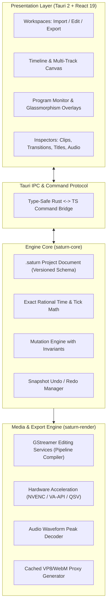

# Easy Edits Pro — Architectural & Product Planning Roadmap

**Document Status:** Living Master Plan  
**Last Updated:** 2026-10-16  
**Architecture:** Tauri 2 (React 19 + TypeScript) + Rust Core (`saturn-core`) + GStreamer GES (`saturn-render`)  
**Repository:** [github.com/zvirox/easy-edits-pro](https://github.com/zvirox/easy-edits-pro)

---

## 1. Vision & Product Identity

**Easy Edits Pro (EEP)** is an open-source, high-performance desktop video editor built for creators who want the editing depth of **Adobe Premiere Pro** and **DaVinci Resolve**, combined with the speed, memory safety, and hackability of a modern Rust-powered application.

### Key Tenets

1. **Distinct Linux Rice & Wayland Identity:**
   Rather than copying traditional desktop NLE designs from the 2000s, Easy Edits Pro is engineered with a modern aesthetic tailored for contemporary Linux desktop rices (Hyprland, Niri, Sway, GNOME Wayland). It features an obsidian dark canvas (`#080a0f`), 1px subtle glowing borders, electric cyan (`#00f2fe`) and neon violet (`#a855f7`) accents, and tactile micro-interactions (`:active { transform: scale(0.96); }`).
2. **Easy of Use Meets Pro Power:**
   Beginners can jump in immediately with a clean Welcome Screen, simplified Import/Edit/Export workspaces, smart presets, and one-click shortcuts. Professional editors gain access to multi-track compositing, sample-accurate audio, keyframed bezier curves, GStreamer hardware-accelerated exports, and a headless JSON Lines automation protocol.
3. **Rock-Solid Core Architecture:**
   Inspired by the architectural rigor of projects like **FilmCraft**, all editing operations, timeline invariants, undo/redo history, and schema migrations belong to a framework-independent Rust engine (`saturn-core`). The Tauri/React UI acts as a clean presentation and interaction layer.

---

## 2. Architectural Foundation & Engineering Principles

1. **Single Source of Truth:** All project state mutations flow through deterministic Rust commands (`saturn-core`). Every command features parameter validation, invariant checking, undo/redo serialization, and atomic persistence.
2. **Exact Rational Time Math:** Timeline time is maintained using 64-bit integer ticks mapped to rational frame and sample rates. Floating-point conversions happen only at the outer rendering and UI boundaries to prevent cumulative frame drift.
3. **Preview & Export Render Parity:** The live Program Monitor and the final GStreamer export pipeline share identical compositing rules, transition curves, color transforms, and title overlays.
4. **Resilient Document Persistence:** Project files (`.saturn`) use explicit schema versions with migration paths, atomic write-replace file strategies, and automatic recovery from unsaved sessions.
5. **Continuous Verification:** Every editing workflow must be backed by unit tests, property tests, and Playwright end-to-end acceptance tests.

---

## 3. Comprehensive Multi-Phase Roadmap

| Phase | Title | Priority | Status | Description & Core Deliverables |
|---|---|---|---|---|
| **Phase 0** | **Reliability Baseline & Core Interaction** | P0 | **Completed** | Welcome screen, multi-file media import, drag-and-drop pointer placement with frame snapping, playhead scrubbing, transport controls, split/move/ripple delete, atomic save/restore, and Playwright E2E smoke suite. |
| **Phase 1** | **Transitions, Titles & Waveform Visualization** | P0 | **Completed** | Video/audio transitions (`Crossfade`, `Dip to Black`, `Dip to White`, `Wipe`, `Slide`) with timeline handles and GES rendering; glassmorphic Title & Lower-Third graphics with live monitor overlay and GES title export; GStreamer peak audio waveform generation and SVG rendering; Hyprland/Niri modern UI polish and pro shortcuts. |
| **Phase 2** | **Playback & Render Consistency, Background Jobs** | P0 | **Next Up** | Shared frame evaluation path between preview and export; background decode/render workers with cancellation and cache invalidation; frame-accurate audio/video synchronization across cuts and gaps. |
| **Phase 3** | **Core Effects Stack, Video Filters & Color Grading** | P1 | **Scheduled** | Composable, typed effect stack replacing hardcoded fields; effect registry (Transform, Opacity, Brightness, Saturation, Blur, Crop, Vignette, Chroma Key); keyframe parameter animation; real-time video scopes (Waveform, Vectorscope, Histogram). |
| **Phase 4** | **Multi-Track Audio Mixing Console, Automation & DSP** | P1 | **Scheduled** | Dedicated audio mixer workspace with per-track faders, pan dials, and peak VU meters; interactive rubber-band volume envelopes; audio DSP suite (Parametric EQ, Compressor, Noise Gate, Reverb); high-fidelity export mixing. |
| **Phase 5** | **Advanced Editing Workflows, Curve Editor & Trimming** | P1 | **Scheduled** | Bezier keyframe graph editor for smooth velocity curves and speed ramps; professional trimming tools (Ripple Edit, Rolling Edit, Slip, Slide, Rate Stretch); multi-track compound sequences / nested clips; markers and chapter points. |
| **Phase 6** | **Media Management, Proxies, Relinking & Delivery Queue** | P2 | **Scheduled** | Offline media detection and batch relinking; project consolidation/bundler for portable archiving; automatic background proxy generation with 1-click toggle; non-blocking background batch export queue with presets and hardware encoder selection. |
| **Phase 7** | **Product Polish, AI Smart Actions & Linux Ecosystem** | P2 | **Scheduled** | Timeline-aware AI actions (scene cut detection, silence removal, auto-captions via Whisper); dockable/customizable workspaces; keyboard shortcut presets (Premiere, DaVinci, FCP layouts); verified Linux packaging (Flatpak, AppImage, Arch PKGBUILD, Debian, RPM). |

---

## 4. Phase-by-Phase Deep Dive

### Phase 0: Reliability Baseline & Core Interaction Acceptance
**Status: Completed & Baseline Established**

- **Project Initialization & Recovery:**
  - Responsive Welcome screen allowing new project creation with custom resolution and frame rate presets (1080p24, 1080p30, 1080p60, 4K24, 4K60, Custom).
  - Recent projects list with fast load and missing project notification.
  - Recovery flow for interrupted or crashed sessions.
- **Media Ingest & Metadata Discovery:**
  - Multi-file native dialog import.
  - GStreamer metadata discovery extracting codec, dimensions, frame rate, duration, and audio channel count.
  - Searchable Project media card grid and list view.
- **Timeline Interaction & Drag-and-Drop:**
  - Pointer drag-and-drop from Project panel onto video and audio tracks with visual drop target and frame snapping.
  - Draggable orange playhead supporting smooth scrubbing.
  - Transport controls: Play/pause (`Space`), seek, single-frame stepping (Left/Right arrow keys).
  - Core timeline operations: Split clip at playhead (`Ctrl+K`), move clip across tracks, delete / ripple-delete (`Delete` / `Backspace`).
  - Timeline zoom in/out with track header controls.
- **Verification:**
  - Automated Playwright smoke test (`apps/saturn-tauri/scripts/editor-smoke.mjs`) verifying project creation, media placement, seeking, playback, zooming, and clip movement with mocked Tauri IPC.

---

### Phase 1: Video & Audio Transitions, Title Graphics & Waveform Visualization
**Status: Completed**

- **Video & Audio Transitions:**
  - **Data Model:** `TransitionKind` (`Crossfade`, `DipToBlack`, `DipToWhite`, `WipeLeft`, `WipeRight`, `SlideLeft`, `SlideRight`) and `Transition` struct in `saturn-core` tracking `id`, `kind`, `cut_time`, and `duration`.
  - **Timeline UI:** Visual transition badges positioned directly at clip cut points, clickable selection, real-time duration slider handle, and dedicated Transition Inspector panel.
  - **Shortcuts:** `Ctrl+D` to apply default Crossfade transition to the cut nearest to the playhead.
  - **Export Rendering:** Compiled directly into GStreamer Editing Services pipeline using `ges::TransitionClip`, supporting both cross-dissolves, SMPTE wipes/slides, and dip-to-color effects in final MP4 and WebM exports.
- **Title & Lower-Third Graphics:**
  - **Data Model:** `MediaKind::Title` with `TitleProperties` in `saturn-core` storing main text, subtitle, layout style (`center_title`, `lower_third`, `minimal_pill`), font size, text color, background color, opacity, and X/Y coordinates.
  - **Timeline UI:** Distinct neon-violet timeline clips for titles, draggable placement, split, and duration trimming.
  - **Shortcuts:** `Ctrl+T` to instantly create and insert a new Title Graphic clip at the playhead.
  - **Inspector Panel:** Full Title & Graphic Inspector with live text editing, style selection, color pickers, opacity slider, and position dials.
  - **Program Monitor Overlay:** Live backdrop-filtered glassmorphic overlay rendered on top of the video preview with real-time CSS backdrop blur, vibrant typography, and responsive scaling.
  - **Export Rendering:** GStreamer Editing Services pipeline compiler maps title clips into `ges::TitleClip` overlays with matching text, styling, and positioning in final exports.
- **Audio Waveform Visualization:**
  - **Peak Amplitude Decoding:** GStreamer audio decoding pipeline (`generate_waveform_peaks`) extracting normalized peak amplitudes into 100-bin arrays per audio track.
  - **Timeline Rendering:** Real-time mirrored SVG waveforms rendered across audio clips on the timeline with neon cyan styling, providing visual cues for cuts and audio beats.
- **Modern Linux Desktop Rice Styling (Hyprland / Niri) & Pro NLE UI Fusion:**
  - **DaVinci Resolve 2026 Workspace Bar:** Sequential workflow pages (`Media` Shift+1, `Edit` Shift+2, `Color` Shift+3, `Audio` Shift+4, `Effects` Shift+5, `Deliver` Shift+6) unifying media management, multi-track timeline editing, color grading, Fairlight audio mixer, keyframe motion, and file delivery.
  - **Wondershare Filmora 15 Left Asset Panel:** Visual tabbed navigation (`Media`, `Titles`, `Transitions`, `Audio`, `Stock`, `AI Tools`) featuring instant 1-click visual preset cards for Title templates (`Broadcast Lower-Third`, `Minimal Pill`, `Cinematic Headline`, `Cyber Neon`, `Documentary Card`, `Framed Banner`) and Transitions (`Crossfade`, `Dip to Black`, `Dip to White`, `Wipe Left/Right`, `Slide Left/Right`).
  - **Adobe Premiere Pro Timeline Tool Rail:** Dedicated vertical editing tool rail with single-key shortcuts: Selection Tool (`V`), Track Select Forward (`A`), Ripple Edit (`B`), Razor (`C`), Slip (`Y`), Keyframe Pen (`P`), Hand Pan (`H`), and Zoom (`Z`).
  - **Universal Hover Tooltips:** Automatic floating tooltips with smooth cubic-bezier transitions displaying the tool/action name and keyboard shortcut on hover across all tools, menus, workspace buttons, and timeline controls.
  - **Theme System (Dark / Light Mode):** Dynamic CSS variable theming with an instant header switcher (`Ctrl+Alt+T`) between Obsidian Dark Linux Rice (`#080a0f`) and Pro Studio Clean Slate (`#f1f5f9`), persisted via `localStorage`.
  - Obsidian dark canvas (`#080a0f`), translucent glassmorphic panels, subtle 1px border glows, electric cyan (`#00f2fe`) and neon violet (`#a855f7`) accents.
  - Tactile micro-interactions on button clicks (`:active { transform: scale(0.96); }`), smooth hover transitions, and clean typography with bundled Inter Variable font.

---

### Phase 2: Playback & Render Consistency, Frame Evaluation & Background Jobs
**Priority: P0 — Next Up**

- **Shared Frame Evaluation Architecture:**
  - Unify the frame evaluation model between the preview monitor and export rendering pipeline.
  - Ensure that clip transforms, color grading adjustments, opacity levels, and transition phases produce visually identical results at any given timestamp.
- **Background Worker & Job Management:**
  - Implement a dedicated background job manager in `saturn-core` with support for cooperative cancellation, task prioritization, and progress reporting.
  - Offload heavy tasks: proxy generation, thumbnail extraction, audio peak decoding, and export rendering.
  - Intelligent cache invalidation: invalidate proxy/waveform caches when source media is modified or relinked.
- **Frame-Accurate Transport & Synchronization:**
  - Zero-drift audio/video synchronization across edit cuts, gaps, and mixed frame rate clips (e.g., 23.976 fps, 29.97 fps, 60 fps).
  - Jitter-free playhead scrubbing with debounced proxy frame seeking.
- **Render Status & Feedback Surface:**
  - Subtle, non-blocking UI status pill indicating active background tasks (e.g., "Generating proxies (45%)", "Decoding waveforms").
  - Detailed error reporting modal for hardware encoder failures with automatic fallback to software encoding.

---

### Phase 3: Core Effects Stack, Video Filters & Color Grading
**Priority: P1 — Scheduled**

- **Composable, Typed Effect Stack:**
  - Replace monolithic fixed color fields with an ordered, extensible effect stack on clips and adjustment layers.
  - Each effect implements a standardized parameter schema with validation, defaults, and serializable state.
- **Core Video Effects Registry:**
  - **Transform & Geometry:** Position (X, Y), Scale (Uniform / Non-uniform), Rotation, Anchor Point, Opacity.
  - **Color & Tone:** Brightness, Contrast, Saturation, Exposure, Highlights/Shadows, White Balance (Temperature / Tint), Hue Shift.
  - **Stylize & Filter:** Gaussian Blur, Directional Blur, Sharpen, Crop, Edge Vignette.
  - **Keying:** Chroma Key / Green Screen removal with color tolerance and edge despill.
- **Keyframe Parameter Animation:**
  - Allow adding keyframes to any numeric effect parameter directly from the Inspector.
  - Timeline keyframe track view displaying keyframe diamonds at specific timestamps.
- **Real-Time Video Scopes:**
  - Waveform Monitor (Luma / RGB Parade) for precise exposure and dynamic range analysis.
  - Vectorscope for skin tone line verification and color saturation monitoring.
  - Real-time RGB Histogram.

---

### Phase 4: Multi-Track Audio Mixing Console, Automation & DSP
**Priority: P1 — Scheduled**

- **Multi-Track Audio Mixer Workspace:**
  - Dedicated Audio workspace featuring vertical channel strips for each timeline audio track plus a Master Bus strip.
  - Per-track controls: Long-throw volume fader, pan dial (-100% Left to +100% Right), Mute (`M`), Solo (`S`), and Record/Arm buttons.
  - Real-time peak VU meters with multi-segment color gradation (Green / Yellow / Red clip warning).
- **Interactive Automation Envelopes & Fades:**
  - Rubber-band volume and pan envelope lines drawn directly over timeline audio clips.
  - Draggable keyframe nodes on the clip audio envelope for smooth volume dips (e.g., ducking background music under dialogue).
  - Interactive clip-level audio fade-in and fade-out handles on clip edges.
- **Audio DSP Suite:**
  - **Parametric EQ:** Multi-band equalizer (Low Shelf, High Shelf, Peaking filters) with interactive frequency curve visualization.
  - **Dynamic Processing:** Compressor with Threshold, Ratio, Attack, Release, and Make-up Gain controls; Noise Gate.
  - **Time & Space:** Reverb and Delay effects for spatial depth.
- **Broadcast Delivery & Loudness Compliance:**
  - Integrated LUFS loudness metering (Integrated, Short-term, Momentary) supporting EBU R128 and ATSC A/85 standards.
  - High-fidelity sample rate conversion (44.1 kHz, 48 kHz, 96 kHz) and multi-channel surround mapping (Stereo, 5.1).

---

### Phase 5: Advanced Editing Workflows, Curve Editor & Precision Trimming
**Priority: P1 — Scheduled**

- **Bezier Keyframe Curve Editor:**
  - Visual curve graph panel displaying parameter values over time.
  - Bezier tangent handles for customizable acceleration and deceleration curves (Ease In, Ease Out, Custom Bezier).
  - Speed Ramping tool: smoothly transition clip playback speed from 100% to 500% or down to 20% slow motion with optical flow / frame blending.
- **Professional Trimming Toolset:**
  - **Ripple Edit (`B`):** Trim a clip while automatically closing gaps downstream across all unlocked tracks.
  - **Rolling Edit (`N`):** Adjust the edit point between two adjacent clips without altering the overall sequence duration.
  - **Slip Tool (`Y`):** Change the source in and out points of a clip while maintaining its position and duration on the timeline.
  - **Slide Tool (`U`):** Move a clip along the timeline while adjusting the adjacent clips' head and tail to accommodate the move.
  - **Rate Stretch Tool (`X`):** Interactively drag clip boundaries to re-time playback speed.
- **Compound Sequences & Multi-Track Nesting:**
  - Select multiple clips across multiple tracks and collapse them into a single nested compound clip.
  - Double-click a compound clip to open and edit its internal sequence in a dedicated timeline tab.
- **Timeline & Clip Markers:**
  - Add color-coded markers (`M`) to timeline rulers or individual clips with notes and URL links.
  - Export sequence chapter markers directly into MP4/MKV metadata.

---

### Phase 6: Media Management, Proxies, Relinking & Delivery Queue
**Priority: P2 — Scheduled**

- **Media Management & Relinking:**
  - Automatic detection of missing or relocated media assets upon project load.
  - Interactive Relink Dialog with fuzzy search, directory scanning, and batch path replacement.
  - **Project Consolidate / Archive:** Collect all referenced source media, trimmed to used ranges or copied in full, into a self-contained project bundle directory.
- **Automated Proxy Workflow:**
  - Background generation of lightweight editing proxies (e.g., ProRes Proxy or 720p VP8) for heavy 4K/8K, H.265, or RAW camera formats.
  - Global toggle button ("Use Proxies" / "Use Originals") in the Program Monitor for instant switching between smooth editing and full-quality export.
- **Batch Export Delivery Queue:**
  - Non-blocking export queue panel allowing multiple export jobs to be queued and rendered sequentially in the background.
  - Export presets for major platforms: YouTube (4K/1080p), Vimeo, TikTok/Instagram Reels (9:16 vertical), ProRes Master, High-Quality WebM.
  - Advanced encoder controls: Variable vs Constant Bitrate (CBR/VBR), GOP size, profile/level selection, hardware encoder choice (NVIDIA NVENC, Intel Quick Sync, VA-API, Apple VideoToolbox / software x264).

---

### Phase 7: Product Polish, AI Smart Actions, Extensibility & Ecosystem
**Priority: P2 — Scheduled**

- **AI-Assisted Smart Editing Actions:**
  - **Scene Cut Detection:** Automatically analyze imported long takes and slice them into individual timeline clips at camera cuts.
  - **Smart Silence & Filler Removal:** Automatically detect and ripple-delete pauses, dead air, and filler sounds in speech audio tracks.
  - **Auto-Captioning & Subtitle Generation:** Local, offline speech-to-text powered by embedded Whisper models, generating synchronized subtitle tracks.
- **Workspace Customization & Extensibility:**
  - Freely resizable, dockable, and detachable workspace panels with persistent user layout profiles.
  - Keyboard shortcut customizer with preset emulation for Adobe Premiere Pro, DaVinci Resolve, and Final Cut Pro.
- **Linux Rice Ecosystem & Distribution:**
  - First-class support for Wayland compositors (Hyprland, Niri, Sway, KDE Wayland, GNOME Wayland) with fractional scaling and smooth window tiling.
  - Official release packages: Flatpak on Flathub, portable AppImage, Arch Linux `PKGBUILD` (AUR), Debian (`.deb`), and RPM (`.rpm`).

---

## 5. Target Feature Parity Matrix

| Workflow / Feature Area | Easy Edits Pro (Target) | FilmCraft | Adobe Premiere Pro | DaVinci Resolve |
|---|---|---|---|---|
| **Core Engine** | Rust (`saturn-core`) | Rust engine crates | C++ native engine | C++ / CUDA / Metal engine |
| **Desktop Shell** | Tauri 2 (React + Vite) | Slint / Web / CLI | Custom Adobe UI | Custom Qt/Fairlight UI |
| **Linux Desktop Identity** | Hyprland/Niri Obsidian Rice | Minimal dark desktop | Not natively supported | Traditional pro NLE |
| **Video & Audio Transitions** | **Supported** (GES transitions, handles) | Supported (engine) | Full transition library | Full transition library |
| **Title & Lower-Third Graphics** | **Supported** (Glassmorphic + GES) | Supported (text/captions) | Essential Graphics / MOGRT | Fusion Title templates |
| **Audio Waveforms** | **Supported** (GStreamer peaks, SVG) | Planned / Engine | Multi-channel audio peaks | Fairlight precision peaks |
| **Audio Mixing Console** | Planned (Phase 4) | Engine mixing | Fairlight / Mixer panel | Fairlight DAW integration |
| **Effects & Filters** | Planned (Phase 3 stack) | Registry in progress | Extensive effect library | Node-based Color / OFX |
| **Keyframe Curve Editor** | Planned (Phase 5 Bezier) | Graph editor planned | Effect Controls curve | Spline / Curve editor |
| **Advanced Trimming** | Planned (Phase 5) | Planned | Ripple/Roll/Slip/Slide | Ripple/Roll/Slip/Slide |
| **Export Engine** | GStreamer GES + HW accel | CPU / Custom GPU | Adobe Media Encoder | DaVinci Deliver page |
| **Batch Delivery Queue** | Planned (Phase 6) | In progress | Media Encoder queue | Deliver render queue |
| **AI Smart Cuts / Captions** | Planned (Phase 7 Whisper/Ollama) | Agent command API | Speech-to-Text / Auto-cut | DaVinci Neural Engine |

---

## 6. Development Workflow & Acceptance Criteria

When implementing each phase:
1. **Engine First:** Implement core data structures, commands, undo/redo handling, and tests in `saturn-core`.
2. **Render Integration:** Implement pipeline compilation and export handling in `saturn-render`.
3. **UI & Micro-Interactions:** Connect Tauri IPC commands, build ergonomic React components, and adhere strictly to the Linux rice design guidelines.
4. **Automated Verification:** Add unit tests in Rust and expand the Playwright end-to-end test suite (`apps/saturn-tauri/scripts/editor-smoke.mjs`) to verify new functionality.
5. **Documentation & Release:** Update the roadmap status table and user-facing documentation before merging.
