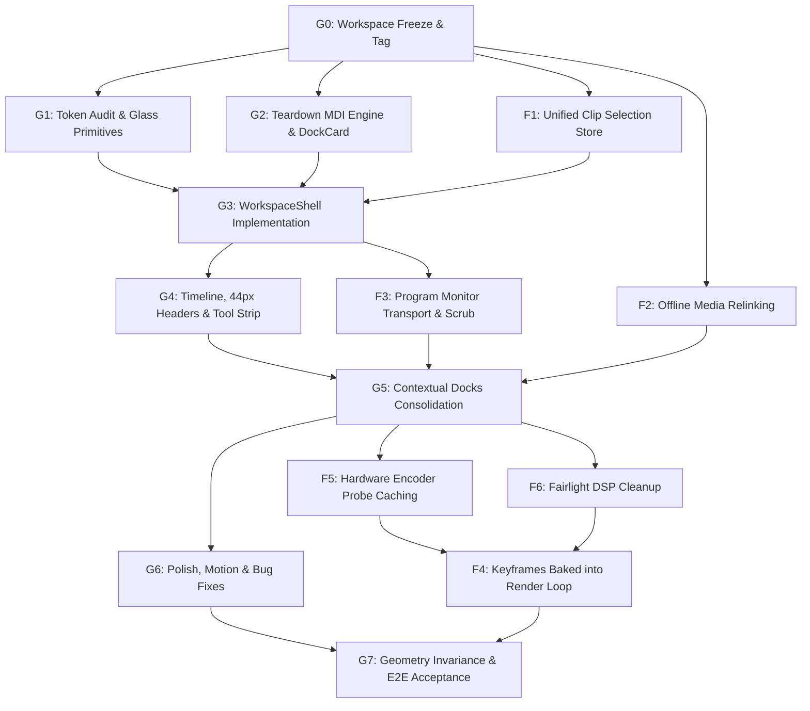

# Easy Edits Pro — Master Delivery & UI Overhaul Plan

**Updated:** 2026-10-23  
**Status source:** Command catalogue generates [PARITY.md](PARITY.md); GitHub Actions is the source for CI and packaging status.

This document serves as the authoritative, forward-looking plan for Easy Edits Pro (EEP). It incorporates the **Executive Architectural Diagnosis**, the **Motrix + FilmCraft Target Hybrid Architecture**, the **UI Correction Plan v4 (Fixed Glass Cards & Persistent 2-Row Viewport)**, and the **Functional Reliability Workstreams (F1–F6)** while resolving all prior roadmap and styling conflicts.

---

## 1. Scope, Design Decisions & Conflict Resolutions

### Core Architectural Decisions

| Decision | Rationale | Resolution / Conflict Elimination |
|---|---|---|
| **Fixed Glass Cards; Zero Window Dragging** | "Floating" is purely visual glass elevation (borders, inner highlight, soft shadows over a frosted, tinted stage). Prior automated development mistakenly implemented a free-floating Multiple Document Interface (MDI) window manager. | **Delete the MDI floating engine** (`FloatingPanel.tsx`, `PanelHost.tsx`, `docking.ts`, `snapping.ts`, `zOrder.ts`, restore pill bar). Panels never detach, drag, pin, minimize, or close. |
| **Existing Colors Are Final & Locked** | The existing plum/magenta glass palette, ambient stage gradients, text, and accent tokens are fully locked and calibrated to WCAG AA contrast gates. | **Reject the PDF's proposed slate color shift** (`rgba(22, 22, 28, 0.78)` / `#110d18`). All surfaces use existing tokens from `00-tokens-glass.css`. Only shape, gap, and elevation tokens are added (`--gap: 12px`, `--radius: 16px`, `--radius-sm: 10px`, `--card-inset`). |
| **Persistent 2-Row NLE Skeleton Across Workspaces** | Switching workspace tabs previously unmounted the editor and mounted isolated full-screen pages with synthetic "SEQUENCE CLIPS REEL" boxes, breaking timeline context. | **Implement a single unified `WorkspaceShell`**. Top-Center Program Monitor, Bottom-Left Toolbox, Bottom-Center Multi-Track Timeline, and Bottom-Right Audio Meter stay permanently locked across all workspaces. Workspaces only swap contextual dock tabs (Dock L / Dock R) and column ratio presets. |
| **Compact 44px Track Headers** | Track headers were bloated to 150px height by horizontal VOL and PAN range sliders, restricting the timeline to a single visible track. | **Standardize on FilmCraft's compact 44px track headers** (Source Patch pill, Lock, Target pill, Name, M/S, Visibility eye). Move per-track gain/pan sliders into the Inspector and Audio Mixer. |
| **Validate on Development Laptop First** | Local testing on the development laptop is the only verified baseline. Avoid cross-hardware claims without local reproduction. | Host path uses software H.264/x264 fallback as ground truth; hardware acceleration detection (nvenc, vaapi, videotoolbox, qsv) is cached asynchronously. |
| **Authoritative Rust Engine Core** | Project state, history, undo/redo, timeline mutations, and export pipelines remain strictly in Rust (`crates/saturn-*`). | React UI and MCP services submit structured commands and render snapshots; client state is never forked. |

---

## 2. Locked Design System & Token Architecture

All UI components must consume the existing design tokens in `00-tokens-glass.css` and `01-editor.css`. **No color value may be modified or added.**

### 2.1 Final Surface & Color Tokens

```css
:root {
  /* STAGE BACKGROUND: Locked radial glow + linear backdrop */
  --bg-stage:
    radial-gradient(48vw 42vh at 18% 22%, rgba(255, 92, 148, 0.2), transparent 62%),
    radial-gradient(42vw 46vh at 82% 74%, rgba(88, 132, 255, 0.18), transparent 64%),
    radial-gradient(36vw 32vh at 62% 18%, rgba(255, 184, 92, 0.1), transparent 60%),
    linear-gradient(160deg, #170c16 0%, #0b060a 54%, #120a14 100%);

  /* GLASS SURFACES: Locked existing tokens */
  --glass-l1: rgba(24, 13, 23, 0.56);
  --glass-border: rgba(244, 215, 235, 0.14);
  --glass-highlight: rgba(255, 255, 255, 0.08);
  --glass-shadow: 0 18px 48px rgba(0, 0, 0, 0.45);
  --blur-l2: 14px;
  --glass-saturate: 145%;

  /* TYPOGRAPHY: Locked existing text tokens */
  --text-primary: #faf2f7;
  --text-secondary: #d4bccf;
  --text-muted: #a890a0;

  /* ACCENT TOKENS */
  --accent-text: #f472b6;
  --accent-primary: #9f1249;
  --accent-text-violet: #c084fc;
  --ring: rgba(244, 114, 182, 0.55);

  /* TRACK & STEM TOKENS */
  --video: #7ad0ff;
  --audio: #6be0a8;
  --gfx: #ffb35c;

  /* SHAPE & ELEVATION: New structural tokens only (No new colors) */
  --gap: 12px;
  --radius: 16px;
  --radius-sm: 10px;
  --card-inset: rgba(255, 255, 255, 0.045);
}

/* Glass Card Primitive (Desktop-Kit Pattern) */
.glass {
  background: var(--glass-l1);
  border: 1px solid var(--glass-border);
  border-radius: var(--radius);
  box-shadow: inset 0 1px 0 var(--glass-highlight), var(--glass-shadow);
  backdrop-filter: blur(var(--blur-l2)) saturate(var(--glass-saturate));
  -webkit-backdrop-filter: blur(var(--blur-l2)) saturate(var(--glass-saturate));
  display: flex;
  flex-direction: column;
  min-width: 0;
  min-height: 0;
  overflow: hidden;
}
```

> [!IMPORTANT]
> **GPU Compositor Safety Rule:** `backdrop-filter` is applied strictly to non-overlapping `.glass` cards over the static root stage. It must **never** be placed over the active `<video>` canvas or wgpu preview surface, ensuring zero blur-kernel re-evaluations during 60 FPS playback.

---

## 3. Persistent 2-Row NLE Viewport Architecture

```
┌────────────────────────────────────────────────────────────────────────────────────────────────────────┐
│                                AppHeader & Global Menus (46px)                                         │
├───────────────────────────────┬────────────────────────────────────────┬───────────────────────────────┤
│   Top-Left Contextual Dock    │   Top-Center Persistent Program        │   Right Contextual Dock       │
│   minmax(260px, 24% - 28%)    │   Monitor (1fr)                        │   minmax(260px, 24%)          │
│   (Swappable Tabs)            │   (GPU Canvas + Scrub + Transport)     │   (Swappable Tabs)            │
├─────┬─────────────────────────┴────────────────────────────────────────┴───────────────────────┬───────┤
│Tool │  Bottom-Center Multi-Track Timeline (1fr)                                                │Master │
│Strip│  (Compact 44px Track Headers, Sequence Tabs, Grouped Toolbar, Playhead, Lanes)          │Meter  │
│52px │                                                                                          │92px   │
├─────┴──────────────────────────────────────────────────────────────────────────────────────────┴───────┤
│                                StatusBar & Telemetry (30px)                                            │
└────────────────────────────────────────────────────────────────────────────────────────────────────────┘
```

### Contextual Dock Tab Mapping per Workspace

The 4-zone lower row (Toolbox, Timeline, Audio Meter, Status Bar) and the Top-Center Program Monitor **never move or unmount**. Clicking workspace tabs changes only the docked tabs in Dock L and Dock R, along with column width presets:

| Workspace Mode | Top-Left Contextual Dock | Top-Center Monitor | Right Contextual Dock | Bottom Row (Tools + Timeline + Meter) |
|---|---|---|---|---|
| **Edit** | Project · Media Browser · Effects | Persistent Program Monitor | Inspector · Titles · Markers | Persistent 4-Zone Bottom Row |
| **Assembly** | Project · Markers | Persistent Program Monitor | Source Monitor · Inspector | Persistent 4-Zone Bottom Row |
| **Color** | Scopes · Project Media | Persistent Program Monitor | Color Wheels · Curves · HSL · Primary Sliders | Persistent 4-Zone Bottom Row |
| **Audio (Fairlight)** | Track DSP Mixer (4-Band EQ, Comp) · Project | Persistent Program Monitor (Picture Sync) | Essential Sound · Channel Strip Rack | Persistent Bottom Row + Expanded Automation Lanes |
| **Captions & Graphics** | Text (Transcript, Captions, Graphics) · Effect Controls | Persistent Program Monitor + Live `CanvasGraphicsLayer` | Essential Graphics Template Browser · Title/Subtitle Inspector | Persistent 4-Zone Bottom Row |
| **Effects** | Effect Controls (Active Stack, AI Matting) · Source | Persistent Program Monitor | Effects Library (Presets, Audio FX, Video FX) · Essential Graphics | Persistent 4-Zone Bottom Row |
| **Curves (Keyframes)**| Keyframe Bezier Curve Editor · Source | Persistent Program Monitor | Interpolation Style & Tangent Handles (Linear, Ease, Bezier) | Persistent 4-Zone Bottom Row |
| **Fusion** | Node Graph Palette & Node Inspector | Fusion Node Graph Canvas (Tabbed with Program Monitor) | Node Parameters & Routing Sockets | Persistent 4-Zone Bottom Row |
| **Deliver (Export)** | 1-Click Delivery Presets · Export Settings | Program Monitor (In/Out Render Range Scrub) | Batch Render Queue · Timeline Interchange (FCPXML, EDL, OTIO) | Persistent 4-Zone Bottom Row |

---

## 4. Teardown of MDI Window Manager

The following legacy window-management files, state stores, and styles are to be completely removed:

* `apps/saturn-tauri/ui/src/features/panels/FloatingPanel.tsx`
* `apps/saturn-tauri/ui/src/features/panels/PanelHost.tsx`
* `apps/saturn-tauri/ui/src/features/panels/docking.ts` (and `docking.test.ts`)
* `apps/saturn-tauri/ui/src/features/panels/snapping.ts` (and `snapping.test.ts`)
* `apps/saturn-tauri/ui/src/features/panels/layouts.ts`
* `apps/saturn-tauri/ui/src/features/panels/presets.ts`
* `apps/saturn-tauri/ui/src/features/panels/presetStore.ts` (and `presetStore.test.ts`)
* `apps/saturn-tauri/ui/src/features/panels/usePanelLayout.ts`
* `apps/saturn-tauri/ui/src/features/panels/usePanelDrag.ts`
* `apps/saturn-tauri/ui/src/features/panels/usePanelResize.ts`
* `apps/saturn-tauri/ui/src/features/panels/zOrder.ts` (and `zOrder.test.ts`)
* `apps/saturn-tauri/ui/src/features/panels/LayoutPresetsDialog.tsx`
* `apps/saturn-tauri/ui/src/styles/140-panels.css` and `171-layout-presets.css`

### Replacement: Stationary `<DockCard>` Primitive

```tsx
export interface TabDefinition {
  id: string;
  title: string;
  render: () => React.ReactNode;
}

export function DockCard({ id, tabs, activeTabId, onSelectTab }: DockCardProps) {
  const active = tabs.find(t => t.id === activeTabId) ?? tabs[0];
  return (
    <section className="glass" id={id}>
      <div className="card-h">
        {tabs.map(tab => (
          <button
            key={tab.id}
            role="tab"
            aria-selected={tab.id === active.id}
            className="tab"
            onClick={() => onSelectTab(tab.id)}
          >
            {tab.title}
          </button>
        ))}
      </div>
      <div className="card-b">{active.render()}</div>
    </section>
  );
}
```

* All 📌 (Pin), - (Minimize), and X (Close) buttons are deleted from panel headers.
* The bottom-right floating restore pill bar (`PANELS | Markers | Video Scopes | Reset layout`) is removed.
* Stale localStorage keys (`easy-edits-pro.panel-layout.*`) are pruned on startup.

---

## 5. Timeline, Track Headers & Toolbox Specification

### 5.1 Compact 44px Track Headers

* Track header height is locked to **44px** (eliminating the 150px bloat).
* **Video Row Anatomy (44px):** `[Source Patch V1] [Lock 🔒] [Target V1] [Track Name] [Sync Lock] [Visibility 👁]`
* **Audio Row Anatomy (44px):** `[Source Patch A1] [Lock 🔒] [Target A1] [Track Name] [Sync Lock] [Mute M] [Solo S] [Voiceover 🎙] [Keyframe ◆]`
* Master Mix footer terminates the audio block with `Mix 0.0`.
* Horizontal VOL and PAN sliders are completely removed from the track header and relocated to the Inspector and Audio Clip Mixer.

### 5.2 Grouped Timeline Toolbar (40px)

Divided by hairlines into 4 clear functional groups:
1. **Edit Modes:** Snap (🧲) · Linked Selection · Ripple Edit
2. **Marking:** Add Marker (M) · Mark In (I) · Mark Out (O)
3. **Tracks:** Add Track (+)
4. **Zoom Navigation:** Zoom Out · Zoom Range Slider · Zoom In

### 5.3 Vertical Tool Strip (52px Card)

Single-column vertical card positioned between the Media Browser and Timeline:
* **Group 1:** Selection (`V`) · Track Select Forward (`A`)
* **Group 2:** Ripple Edit (`B`) · Razor / Blade (`C`) · Slip (`Y`)
* **Group 3:** Hand / Pan (`H`) · Text (`T`)

### 5.4 Master Audio Meter (92px Card)

Flanks the timeline on the far right:
* Dual-channel vertical peak level bars (0 to -57 dB) with green/amber/red grading.
* Live EBU R128 loudness telemetry: Momentary (M), Short-Term (S), Integrated (I), True Peak (TP).

---

## 6. Phase-Wise Implementation Roadmap

Work is organized into two concurrent tracks: **UI Overhaul (Workstream G)** and **Functional Dependability (Workstream F)**.



### UI Workstream G

* **G0 — Codebase Freeze & Safety Tag:** Tag current commit `pre-glass-cards`.
* **G1 — Token Verification & Glass Card Primitives:** Register `--gap`, `--radius`, `--radius-sm`, and `--card-inset` in `00-tokens-glass.css` without modifying any color value. Verify against `pnpm check:contrast` and `pnpm check:tokens`.
* **G2 — MDI Engine Teardown:** Remove all 12 floating panel engine files, purge `save_panel_layout` commands, and establish `<DockCard>`.
* **G3 — Unified `WorkspaceShell` Grid:** Implement the persistent 2-row CSS grid in `WorkspaceShell.tsx`. Route Edit, Assembly, Color, Audio, Captions, Effects, Curves, Fusion, and Deliver as dock tab presets. Delete "SEQUENCE CLIPS REEL" and "Back to Edit" buttons.
* **G4 — Timeline, 44px Track Headers & Tool Strip:** Implement compact track rows in `TimelineTrackLane.tsx`, 52px single-column vertical toolbox, grouped 40px timeline toolbar, and 92px master meter.
* **G5 — Contextual Workspaces Docking:** Mount Color Scopes, Fairlight DSP racks, Fusion Canvas tab, and Deliver Export Settings into Dock L and Dock R without unmounting the Program Monitor or Timeline.
* **G6 — UI Polish & Bug Fixes:** 
  1. Fix top menu overflow below 1300px.
  2. Resolve all missing SVG icons in `Icon.tsx`.
  3. Ensure status bar is never obscured.
  4. Implement smooth 220ms card mount transitions respecting `prefers-reduced-motion`.
* **G7 — Invariance Tests & E2E Validation:** Execute Geometry Invariance tests and Playwright smoke verification.

### Functional Workstream F

* **F1 — Single Reactive Clip Selection Store:** Unify selection across Timeline, Inspector, Effects, Color, and Curves. Auto-select the first clip on V1 upon sequence load.
* **F2 — Media Ingestion & Offline Relinking:** Correct local range stream URLs in `mediaUrl.ts`, ensure `useMediaServer.ts` initializes prior to project recovery, and add a one-click "Relink Media" action in `MediaPanel.tsx`.
* **F3 — Program Monitor Transport & Telemetry:** Align transport bar (10 buttons: Add Marker, Mark In/Out, Step, Play, Lift, Extract, Export Frame), blue playhead timecode, Fit zoom dropdown, and resolution divider.
* **F4 — Keyframe Render Baking:** Wire `interpolation.ts` keyframe evaluator into `crates/saturn-render/src/lib.rs` export loop, baking transform, opacity, and audio automation into MP4 output.
* **F5 — Hardware Encoder Probe Optimization:** Run GStreamer hardware encoder detection asynchronously at startup, caching results so the Deliver workspace never stalls.
* **F6 — Fairlight Plugin Host Cleanup:** Clean up placeholder slots; ensure active audio tracks bind directly to 4-band parametric EQ and compressor.

---

## 7. Master Agentic Execution Rules

All coding agents working on Easy Edits Pro must strictly adhere to these six execution directives:

1. **Sequential Phase Locking:** Execute phases in strict dependency order. Every phase must pass `cargo test --workspace` and `pnpm --dir apps/saturn-tauri build` before advancing.
2. **Zero MDI Window Controls:** Never render 📌, -, or X buttons on workspace panel headers. All panels must mount inside stationary `DockCard` containers.
3. **Zero Overlapping Popups:** Never use `position: absolute` or `position: fixed` to float feature panels over the Program Monitor or Timeline. Only modal dialogs in `features/dialogs/` may center as overlays.
4. **GPU-Safe Frosted Glass:** Apply `.glass` only to fixed cards over the root ambient stage. Never apply `backdrop-filter` or blur shaders over the active video preview canvas.
5. **Persistent Core NLE Skeleton:** Never unmount the Top-Center Program Monitor, Bottom-Left Tool Strip, Bottom-Center Timeline, or Master Audio Meter when switching workspace modes.
6. **Compact 44px Track Headers:** Never place horizontal volume or pan range sliders inside timeline track headers. Enforce FilmCraft's 44px micro-icon row standard.

---

## 8. Verification & Acceptance Gates

Before claiming completion of any phase, run and pass all gates:

```bash
cargo test --workspace
pnpm --dir apps/saturn-tauri build
pnpm --dir apps/saturn-tauri test
pnpm --dir apps/saturn-tauri check:contrast
pnpm --dir apps/saturn-tauri check:styles
pnpm --dir apps/saturn-tauri check:tokens
pnpm --dir apps/saturn-tauri check:commands
pnpm --dir apps/saturn-tauri check:source-size --max-lines=800
pnpm --dir apps/saturn-tauri test:e2e
```

### Specialized Acceptance Tests

* **Geometry Invariance Test:** Measure bounding boxes of Top Bar, Program Monitor, Tool Strip, Timeline, Audio Meter, and Status Bar across all workspace tabs at 1280×720, 1600×900, and 1920×1080. Assert bounding box deviations are $\le 1\text{px}$.
* **No-Overlap Test:** Assert no two `.glass` card bounding boxes intersect under any layout state.
* **Zero Color Token Drift:** Assert `git diff` on `styles/00-tokens-glass.css` shows 0 modified or added color hex/rgba values.
* **Source Size Ceiling:** All new and modified `.ts`, `.tsx`, `.rs`, and `.css` files must strictly remain $\le 800$ lines.
